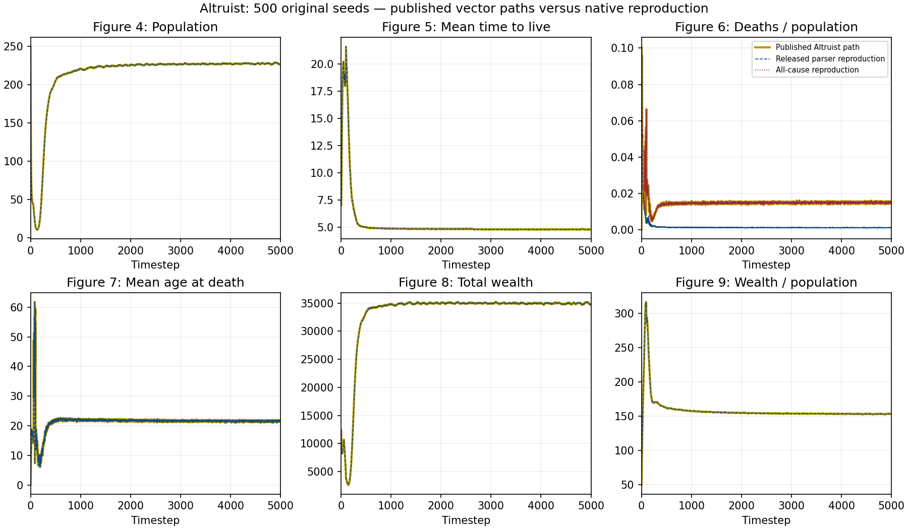

# Complete Altruist curves against published figures

The complete 500-input cohort contributes 840,379 native timestep observations.
Independent aggregation and the unchanged released parser agree on all 30,006
compared values. Population means agree exactly; other numerical differences
remain below the existing relative/absolute tolerances of `1e-12`/`1e-8`.
Missing post-extinction rows contribute zero, with a fixed denominator of 500.
Derived ratios divide ensemble means rather than averaging individual ratios.

The gold Altruist legends and axes were visually checked on PDF pages 13–14.
All vertices of each relevant vector path are compared, using the same
0.005 PDF-point tolerance previously used for Raw Sugarscape.

| Figure | Metric | Vertices | Maximum error, PDF points |
| --- | --- | ---: | ---: |
| 4 | Population | 4,850 | 0.003874 |
| 5 | Mean time to live | 4,889 | 0.004527 |
| 7 | Mean age at death | 4,997 | 0.004637 |
| 8 | Total wealth | 4,845 | 0.003790 |
| 9 | Wealth / population | 4,811 | 0.003215 |

All 24,392 vertices pass. Figure 6 again exposes the death-definition discrepancy:
the released parser includes starvation and combat, whereas the published path
agrees with starvation, combat, disease, and aging combined.
The released definition has maximum error 45.017430 PDF points.
The all-cause definition matches all 4,995 vertices, with maximum error 0.003700 points.
At timestep 5,000, the respective rates are 0.001110739 and 0.014280929.
The mean aging-death count is 2.988, versus 0.252 starvation deaths and zero
combat or disease deaths. No simulation behavior was changed.

The all-cause comparison was specified before examining these Altruist errors,
using the earlier Raw discrepancy. This is not independent of prior findings
and does not identify the exact historical plotting revision.



The comparison plot was visually inspected. Its six panels retain both death
definitions so the released-parser mismatch remains visible.
These results reproduce this model's curves, not cross-model rankings or the whole paper.

`protocol.json` records the selected paths, axes, definitions and tolerance.
`timeseries/` retains the parser audit, pinned input ledger, means, command and receipts.
`initial-comparison.json` and `death-definition-diagnostic.json` retain both outcomes.
Exported numeric files are gzip-compressed; every compressed file was checked
against its original bytes. `provenance.json` pins all exported evidence.
The full native JSON staging remains in the external evidence directory.

To repeat the complete native aggregation, run:

```sh
python replications/blueprints_2024/audit_timeseries.py COVERAGE.json PINNED_ENGINE altruisticHalfLookaheadBinary NEW_TIMESERIES
```

Copy the retained `timeseries/provenance.json` into that directory after checking
that the four auditor-pinned files have their recorded hashes. Then run:

```sh
python audit_figures.py PAPER.pdf NEW_TIMESERIES NEW_FIGURE_AUDIT
```

Native input staging is required for the death-cause comparison. For plotting
only, decompress the retained CSV files and run `python plot.py` in this directory.
