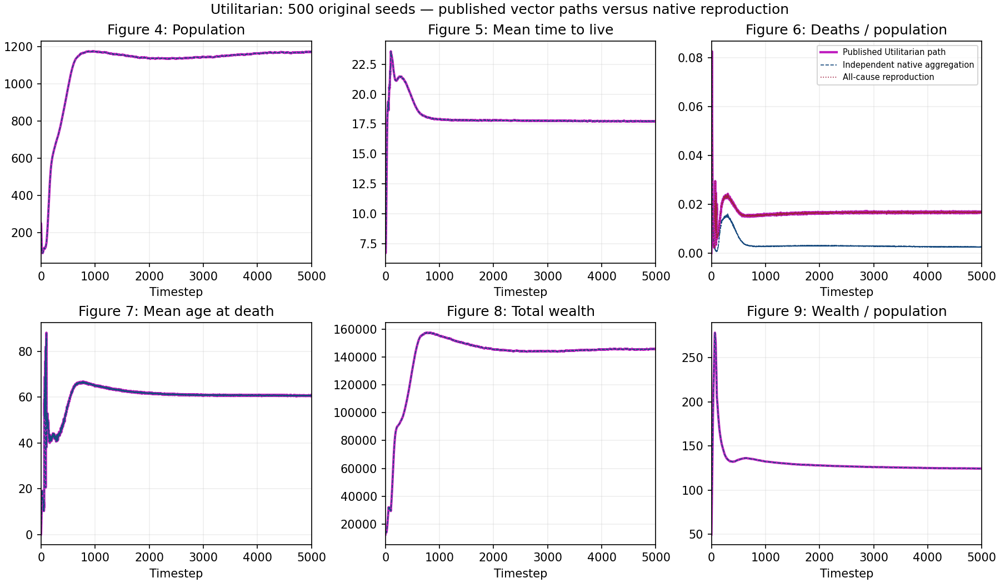

# Complete Bentham curves against published figures

All 500 original Bentham inputs contribute 2,500,500 observations. Every native trajectory hash matches the complete audited coverage. Independent aggregation retains all 5,001 timesteps, uses denominator 500, and divides ensemble means for derived ratios.

Magenta Utilitarian legends and axes were visually checked on PDF pages 13–14. The existing 0.005 PDF-point tolerance and both death definitions were retained before inspecting these errors.

| Figure | Vertices | Maximum error, PDF points |
| --- | ---: | ---: |
| 4 | 4,933 | 0.003663 |
| 5 | 4,931 | 0.003318 |
| 7 | 4,995 | 0.004344 |
| 8 | 4,922 | 0.004158 |
| 9 | 4,448 | 0.003679 |

All 24,229 vertices pass. Figure 6 matches all 4,987 vertices under all-cause deaths, with maximum error 0.004067 points. Starvation plus combat alone has maximum error 20.166303 points. At timestep 5,000, the rates are respectively 0.016826259 and 0.002393030. Mean deaths are 2.806 starvation and 16.924 aging; combat and disease are zero.

The all-cause definition was motivated by prior model comparisons, not selected from these Bentham errors. The historical plotting revision remains unidentified. No simulator behavior changed.

The six-panel comparison was visually inspected. This verifies the Bentham plotted curves against independent aggregation. [The subsequent full parser check](../bentham-parser-2026-10-18) now verifies all 30,006 values against the unchanged release. Other paper experiments remain incomplete.

`timeseries/aggregate.py` reconstructs the ensemble from retained native outputs, checking every input against coverage and trajectory hashes. Its retained candidate inventory locates relocated evidence without modifying it. Decompress `candidate-inputs.json.gz` before rerunning with the original coverage and evidence paths available.

`audit_figures.py PAPER.pdf TIMESERIES NEW_OUTPUT` verifies the paper and aggregation hashes, extracts every vector vertex, and recomputes both death definitions. Decompress CSV exports before use. Native trajectories remain in the already published source evidence; `inputs.json` records their verified paths and hashes. Export verification checks every retained CSV byte after decompression. No raw trajectory staging was needed for this independent comparison.
