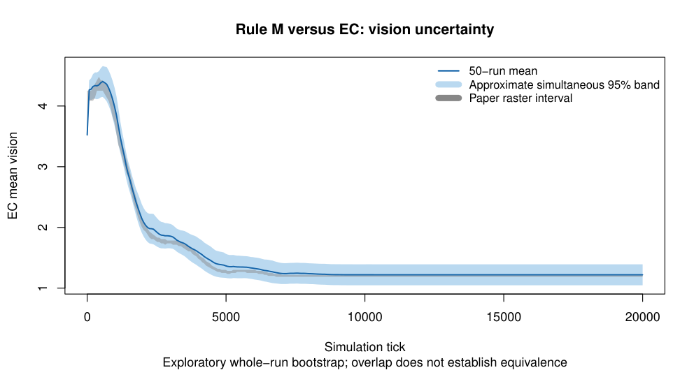

# EC vision: whole-run uncertainty diagnostic

The corrected Rule M/EC comparison places the simulation range above the paper raster interval at 245 of 286 columns.
These columns are dependent observations from the same 50 runs, not 245 independent failures.
This exploratory diagnostic was selected after inspecting that discrepancy; it does not replace the replication criteria.

We reuse the existing 20,000 whole-run bootstrap draws and evaluate all 286 column centers.
For each draw, we take the maximum absolute mean deviation divided by the original standard error across those centers.
The 95th percentile is 2.918049728593882; this gives an approximate simultaneous band for our mean curve on this grid.
It is not a band for the paper’s unknown historical sampling process or other metrics.
Standard errors stay fixed across draws; this is not a bootstrap-t calculation.

All 286 paper raster intervals overlap this band.
At column centers, 258 observed means exceed the upper paper bound, with a largest excess of 0.09141044 vision units.
The 258 center comparisons differ from the original 245 horizontal-window comparisons by definition; neither count is a significance test.
Sampling uncertainty is therefore a plausible explanation for this discrepancy. This does not prove the implementations equivalent or identify the historical seeds.

Independent R rereads and hashes all 50 native trajectories, checks 1,000,050 observations, and repeats interpolation and resampling arithmetic.
Maximum absolute differences are 1.34e-14 for interpolated inputs, 3.38e-14 for bootstrap maxima, and 1.34e-15 for band endpoints.
Both implementations find 286 overlaps. They share retained random draws and do not independently validate the random-number generator.

The [PDF figure](ec-vision-band.pdf), per-column bands, native-source hashes, bootstrap maxima, protocol, and both analysis scripts are retained.
No new simulation or completed-study credit is added. Full ensembles, paper-table parameter sensitivity, and independent fork implementation remain outstanding.
