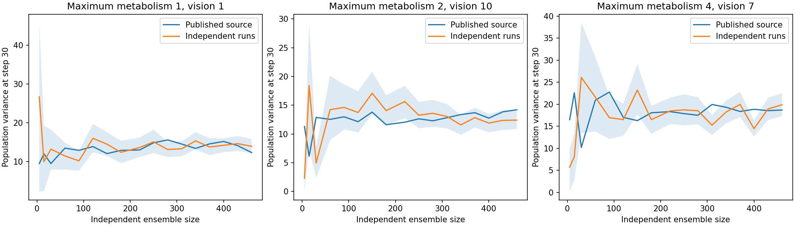

# McCulloch et al. (2022): completed study with mixed results

Scope: Sugarscape Figures 3–6, not the paper's bird or cattle models.
Outcome: **validated negative replication of exact stabilization by step 30**, with conditional posterior agreement.
This counts as one completed study under the user's policy permitting validated negative replications.
It does not count as a wholly positive replication of the paper.

## Claim-level results

| Target | Evidence | Verdict |
| --- | --- | --- |
| Figure 3: all runs stable by step 30 | At (4,7), 3/30 declared runs remain exactly constant through step 100; 21/220 in the expanded ensemble | Negative under the predeclared exact-stability definition |
| Figure 3: other parameter pairs | Both (1,1) and (2,10) remain constant in all 220 runs | Reproduced in these ensembles |
| Figure 4: population variances and ensemble-size curve | All 17 released ensemble sizes repeated independently at all three parameter pairs: 11,130 simulations | Curve recomputed; sampling variation remains; no unsupported exact-equivalence claim |
| Figure 5: history matching | Eight waves, 64→21 combinations; archive has ten waves, 64→15 | Procedure reproduced; historical random path differs |
| Figure 6: posterior on the archived prior | 10,000 accepted particles, total variation 0.0198, bootstrap upper bound 0.0374 < declared 0.05 | Distribution criterion passed |
| Figure 6: exact modal parameter label | New (3,2): 1,027; (4,7): 1,024; (4,6): 1,018 | Label differs; three-particle lead is not substantive contrary evidence |
| Complete pipeline | Fresh history matching followed by 10,000 accepted particles; mode (4,6) | Executed and retained; prior differs from the archive |

Pairs are (maximum metabolism, maximum vision).
The negative result concerns **exact** stabilization, not the looser proposition that curves become approximately flat.
At (4,7), population loss from steps 30–100 averages 2.386 agents across 220 runs, with maximum loss eight.
The authors' historical seeds are unavailable. This study cannot disprove what happened in their particular 30 original runs.
It shows that their released model does not reproduce the all-runs exact-stability result in the declared new ensemble.

## Why this is not an unexplained implementation mismatch

- The author model files are unchanged, pinned, and licensed. The independent implementation calls neither Mesa nor DTL.
- All 660 independent population trajectories exactly match author-code trajectories: 66,660 observations.
- Complete-world comparisons pass for 80 simulations of 100 steps, including every one of the 64 calibration parameter pairs.
  At every step they compare agent positions and sugar, all 2,500 resource cells, occupancy, population, and random-generator state.
- Mesa 0.8.7 reproduces all 90 checked trajectories from Mesa 0.8.8 exactly, including the stabilization discrepancy.
  Both versions predate the archived February 2021 calibration. The authors did not specify their installed version.
- Movement, boundaries, resource growth, death, scheduling, initialization collisions, and inactive occupants follow released-code semantics.
  The prose's 100 starting agents can become fewer scheduled agents because duplicate position identifiers overwrite one another.
- The calibration analyzer recomputes every history-matching decision and validates every accepted/rejected particle against raw simulation results.
- DTL's own import/logging bugs were fixed separately. Its remaining model differences are documented and are not used as negative paper evidence.

## Evidence and limits

The [initial audit](results/audit-2026-10-15/RESULTS.md),
[independent trajectories](results/independent-2026-10-15/comparison.json),
[dependency check](results/mesa087-2026-10-15/dependency-validation.json),
[complete variance experiment](results/variance-2026-10-15/summary.json), and
[calibration report](results/calibration-2026-10-15/RESULTS.md) retain configurations, seeds, hashes, and results.
See the README and committed protocols for executable commands.

The Figure 4 source does not define a numerical threshold for "variance stabilized."
We therefore report its curve and uncertainty without inventing a retrospective pass threshold.
At n=220, the new independent variances are 13.622, 15.634, and 18.487;
the released values are 12.997, 12.047, and 18.340.
Pointwise bootstrap intervals describe uncertainty in new samples only; they are not simultaneous two-sample equivalence tests.

The paper and released code also differ in their uncertainty formulas.
This study reproduces the released calibration implementation: twice the mean variance of absolute errors for history matching,
and its square root as the rejection threshold. It does not silently substitute the paper's general formula.
That distinction limits any broader methodological conclusion.

The study-specific implementation is part of the Metta-AI fork. It is not a claim that the general DTL engine now matches every Sugarscape variant.
