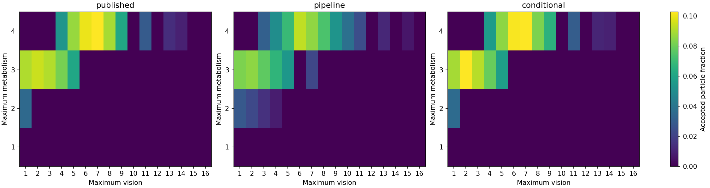

# Recorded calibration results

Both experiments produced 10,000 accepted particles using the independent implementation.
All accepted and rejected trials are retained in `trials.jsonl`.
The analyzer recomputes every history-matching uncertainty, score, and retained set from those trials.
It also verifies the acceptance threshold, rejection history, and final recorded particle for every accepted sample.

| Target | Published archive | New result | Interpretation |
| --- | --- | --- | --- |
| History-matching waves | 10 | 8 | Different stochastic path; exact historical path not reproduced |
| Final plausible combinations | 15 | 21 | Seven new-only combinations and one archive-only combination |
| Full-pipeline posterior mode | (4,7) | (4,6), 928 particles | Different prior makes this a different conditional inference |
| Fixed-prior posterior mode | (4,7), 1,027 particles | (3,2), 1,027 particles | Exact modal label differs; (4,7) has 1,024 and (4,6) has 1,018 |
| Fixed-prior distribution distance | Reference | 0.0198 | Bootstrap 95% upper bound 0.0374; passes predeclared bound 0.05 |
| Fixed-prior simulator calls | 22,270 after correcting archived counter offset | 22,022 | Similar rejection cost; exact random sequence unavailable |

Parameters are (maximum metabolism, maximum vision).
The full pipeline used 27,031 rejection-stage simulator calls, in addition to history matching.
The fixed-prior experiment holds the authors' 15 combinations and variance 17.898567839195984 unchanged.
Its total variation distance measures aggregate probability-mass disagreement.
The bootstrap bound is an approximate sampling-uncertainty estimate under the predeclared procedure.
It is not a guarantee about an unobserved true posterior.

The three-particle lead of (3,2) over (4,7) does not establish a different underlying modal probability.
Likewise, one different history-matching path does not refute the published ten-wave realization.
Those outcomes must not be counted as validated negative findings by themselves.



Regenerate all checks and the plot from this committed directory:

```sh
.venv/bin/python replications/mcculloch_2022/analyze_calibration.py \
  replications/mcculloch_2022/results/calibration-2026-10-15 --output /absolute/new/analysis/path
```

The Figure 3 exact-stabilization discrepancy remains separate from these calibration results.
See the study README for implementation validation, dependency checks, and remaining work.
