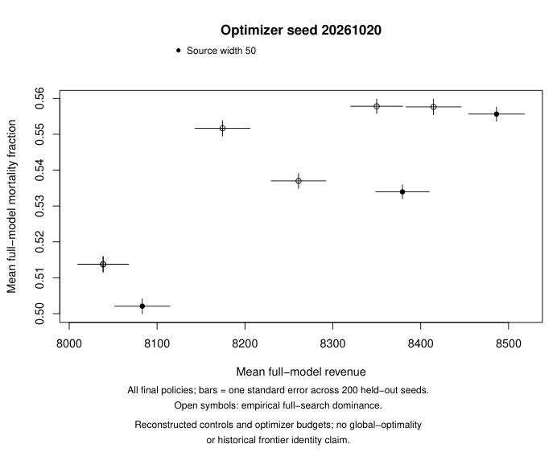

# Held-out transfer reporting qualification

Independent R recomputes 3,600 objective values from 1,800 native runs covering nine policies and three qualified search variants.
Every mean, standard error, and empirical full-search dominance decision matches the existing Python audit.
All native inputs and output hashes are checked before reporting.
These qualification searches all use width 50 and one optimizer seed; this is not a reduced-model transfer result.



Each point represents one final policy. Coincident policies remain separate rows in the accompanying CSV.
Bars show one standard error over 200 held-out simulator seeds, not simultaneous confidence intervals.
Open symbols denote empirical dominance by another full-size search policy, not proven statistical superiority.
The first rendering clipped footnotes and overlapped a legend; external evidence retains it.
The corrected figure was visually inspected, and all objective rows remained byte-identical.

A separate bounded watcher waits for all eighteen production searches and their transferred frontiers to pass audit.
The same R program then includes every final policy, with shared axes, fixed width colors, and one panel per optimizer seed.
The full report and its visual inspection remain pending. No native simulations are added or restarted.
Optimizer budgets and reconstruction conventions remain explicit; no global-optimality or historical frontier identity is inferred.

```sh
Rscript --vanilla report.R TRANSFER_RUN TRANSFER_AUDIT.json NEW_OUTPUT
```

The R program requires `jsonlite` and `digest`.
