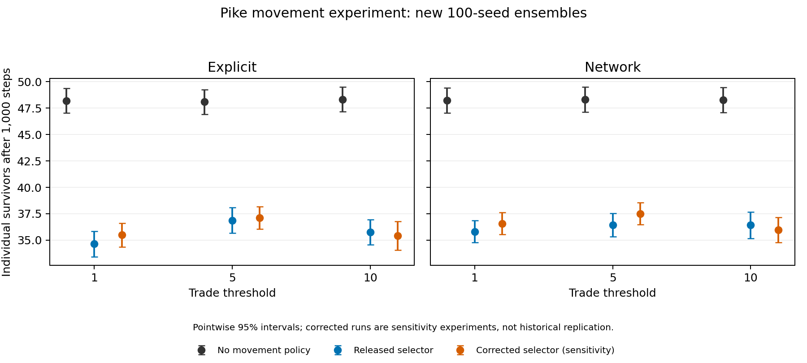
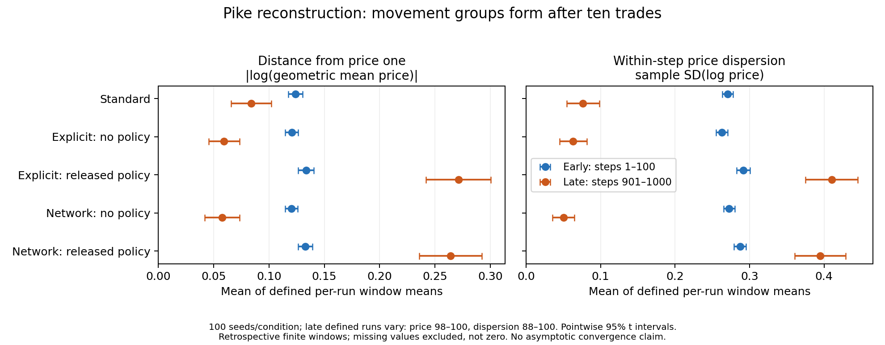
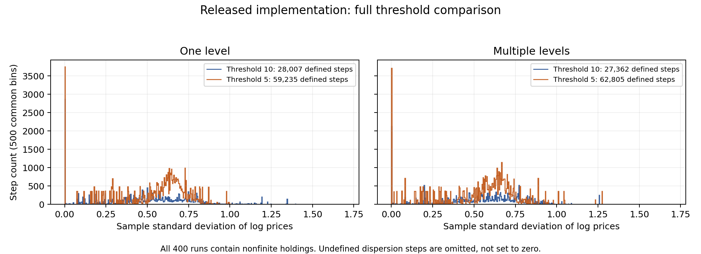

# Multi-Level Mesa (Pike, 2019)

Status: **incomplete study**. All declared native experiment grids and the controlled timing ensemble have completed their audits. Numerical validity, historical source fidelity, and several published interpretations remain unresolved.

## Current claim coverage

Later complete analyses supersede the launch and prefix records retained below.

| Paper target | Current evidence | Unresolved requirement |
| --- | --- | --- |
| Phase I survival and prices | [300 runs](results/phase1-analysis-2026-10-17/analysis.json); native notebook histograms independently reconstructed | Historical survivor means differ; original seeds and equivalence margin unavailable |
| Phase II trade thresholds | [600 runs](results/phase2-analysis-2026-10-17/analysis.json), thresholds 1/5/10 | Similar means and intervals spanning zero do not prove the reported equivalence |
| Movement policies | [1,200 runs](results/phase3-analysis-2026-10-17/movement/analysis.json), including separately labeled selector corrections | Released selector disagrees with the stated rule; corrections do not establish historical behavior |
| Price-direction claims | [2,100-run analysis](results/convergence-2026-10-17/analysis.json) supports finite-horizon directions | Retrospective windows do not establish asymptotic convergence or recover the plotted historical trajectories |
| Common-resource thresholds | [400 conditions](results/common-threshold-complete-2026-10-17/comparison.json), all seeds at thresholds 5/10 | Every condition contains nonfinite holdings; the approximately 400-higher central-peak claim lacks a precise comparison target |
| Runtime comparisons | [900 controlled runs](results/timing-complete-2026-10-17), native and full-step timers | Native timing excludes network reassessment; common-resource timings accompany invalid economic trajectories |

Historical source identification remains shared across these targets. The released
shared-resource code double-counts stale contributions in a passive, byte-identical
trace. Separately labeled conservation and lifecycle corrections change model rules;
they cannot be substituted for a faithful historical replay. The completed grids
therefore do not establish either a positive or validated negative whole-paper result.

Direct inspection of Figure 3-9 (PDF page 26) shows only the threshold-ten comparison.
It supplies no threshold-five histogram from which to recover the prose's central-peak
increase. The largest bin in our histograms is not substituted for that unspecified
central peak. This is a target-definition limitation, not an omitted ensemble.


The [paper](https://arxiv.org/abs/1904.08315) links the author's [Sugarscape](https://github.com/tpike3/SugarScape) and [Multi-Level Mesa](https://github.com/tpike3/multilevel_mesa) implementations.
We select their last pre-publication revisions, respectively `585e53398f4f58e89ec184c83bb20819f0e4c96a` and `99d2091721076df9fff32e8b49a0e33e98c34a6f`.
Chronology does not prove these are the exact paper versions. Both repositories have MIT licenses; simulation sources remain in separate unchanged checkouts.

## Execution and measurements

`run.py ENGINE LIBRARY standard|explicit|network NUMPY_SEED NEW_OUTPUT` runs 1,000 steps with the released 200-agent, 50×50 configuration and Mesa seed 42.
Use Mesa 0.8.5. Historical library requirements specify Mesa >=0.8.5 and NetworkX >=2.2.
Our initial runtime uses Python 3.11.14, NumPy 1.26.4 and NetworkX 3.6.1; it is not claimed to match the historical environment.
Mesa 0.8.4 lacks the required model random generator. Mesa 0.8.8 changes grid containers, breaking the original empty-cell comparison.
The author's 2021 fix is not applied to these historical runs.

The released runners fix Mesa seed 42 but leave NumPy unseeded. Our explicit NumPy seed makes replication possible; original NumPy states are unavailable.
The runner retains source hashes, initial agents, native price records, native model reporters, individual identities and health records.
It reads agent registries after each native step without drawing random numbers or modifying the model.
The network variant's native `survivors` reporter counts scheduled groups/resources, so it must not be interpreted as individual population.
Individual counts instead use `ml.agents_by_type[NetAgent]` and reconcile with native health records.

`audit_observation.py NATIVE OBSERVED NEW_OUTPUT` requires byte-identical native price and reporter outputs, then checks every surviving identity against health records.
Initial standard and explicit pilots each finish with 47 individual agents. Each is one run, not an ensemble estimate.
The standard pilot repeats byte-identically in a separate process. Observer validation covers 1,000 steps and 51,622 standard or 51,642 explicit health records.

## Targets and full scope

[Extracted notebook targets](notebook_targets.json) retain source cells, cached outputs and notebook hashes.
Five original multi-level common-resource data files are retained in the author's repository and audited below.
The earlier claim that all original raw datasets were omitted was incorrect.
Other experiment datasets remain unrecovered; cached outputs are reference evidence, not regenerated results.
Phase I cached mean survivors are standard 46.18, explicit 46.96 and network 46.68.
Common-resource cached means are one-level 94.35 and multi-level 92.83, matching the paper.
The notebooks multiply SciPy's already two-sided `ttest_ind` p-values by two, including a reported value above one.
Report the original analysis and correctly computed p-values separately; nonsignificance alone does not establish equivalence.

The full study scope covers the paper's Sugarscape experiments:

- Phase I: three approaches, 100 runs of 1,000 steps each; price convergence, dispersion, trade volume and survivor distributions.
- Phase II: explicit/network groups at thresholds of one, five and ten trades, with 100 runs per configuration.
- Phase III: group movement policies and one-level/multi-level common resources, including threshold comparisons and survival effects.
- Audit price aggregation against the original notebooks and preserve failed runs and undefined statistics.
- Quantify seed uncertainty; identify historical configuration differences before any negative verdict.
- Assess runtime comparisons on a controlled machine; historical wall-clock seconds are not portable targets.

Native ranges also need explicit accounting: `randint(1,6)` and `randrange(25,50)` exclude their upper endpoints, whereas the paper describes inclusive-looking ranges.
No rules or ranges are silently changed to match the prose. This PR establishes the runnable reference study inside the Metta-AI fork; independent model integration and full replication remain outstanding.

[Retained pilot evidence](results/pilots-2026-10-16) now includes all three observer audits and compressed raw records.
The network pilot has 47 individual survivors but a native reporter value of 2,544 at termination.
All three observer replays match their native price and reporter outputs byte-for-byte, covering 3,000 steps and 154,898 health records.
Notebook source excerpts are distributed under the [author's MIT license](AUTHOR_LICENSE).

## Full Phase I launch

[The declared protocol](PHASE1_PROTOCOL.md) specifies 300 runs: all three original approaches, NumPy seeds 0–99, fixed Mesa seed 42, and 1,000 steps each.
`run_phase1.py ENGINE LIBRARY NEW_OUTPUT` freezes the runner and protocol, executes one worker, and records exact commands, file hashes, exit codes and all terminal outcomes.
The live run uses the validated runtime. A free-space guard stops below 2 GiB without deleting evidence.
The ensemble remains incomplete. No inference is made from partial seed coverage, and no failed seed is silently replaced.

### Phase I independent audit

`audit_phase1.py RUN prefix|complete NEW_OUTPUT` checks the ordered seed/variant grid, pinned source hashes, runtime, every raw file, individual identities and native health records.
It reconstructs all 1,000 per-step price measurements per run, preserving missing prices and dispersion rather than imputing zero.
Full mode requires all 300 declared runs; prefix mode produces descriptive records only.

[The first five audited runs](results/phase1-prefix-2026-10-16) cover 259,228 health records and 5,000 price-step records.
Between 829 and 854 steps per run have fewer than two trades, making sample log-price dispersion undefined.
Standard seed 1 has 25 trades during steps 901–1000, each in a different step; its late-window dispersion is wholly undefined.
This is not zero dispersion or evidence of convergence. All raw inputs and derived measurements are retained.
Controls reject both premature complete analysis and a negative transaction price even after its file hash is updated.
These checks validate measurements; aggregate paper comparisons await the full ensemble.

## Released group and shared-resource configurations

The runner also accepts `groups-network`, `policy-explicit`, `common-one` and `common-multi`, mapped to the unchanged author directories in [the source audit](PHASE23_SOURCE_AUDIT.md).
Set `PYTHONHASHSEED=0` before launching Python. The runner records that value and seeds module-level policy randomness with the supplied NumPy seed; Mesa remains seeded at 42.
The already-running Phase I ensemble uses its frozen original runner and remains unchanged.
New observations count retained groups and nested group edges separately from individual population.
These measurements do not alter grouping, policies, thresholds or resource allocation.

The controlled multi-level pilot, branch observer and expanded CLI have byte-identical prices, native reporters, initial agents and health records.
However, numerical validation **fails**: 61,041 of 89,027 health records contain nonfinite holdings, beginning at step 76.
The earlier one-level diagnostic also contains infinite holdings, beginning at step 78.
Operational completion and finite recorded transaction prices do not make these economic outcomes valid.
`diagnose_resources.py NATIVE OBSERVED NEW_OUTPUT` records observer parity and explicitly reports the numerical failure; it does not convert it into a passing audit.

The controlled multi-level pilot makes 71,242 resource-aggregation calls, none with nested-group children.
Independent post-step observation finds nested-group edges on 988 of 1,000 steps, with at most seven edges and eleven retained groups.
Therefore the type-label mismatch is not exercised by the aggregation calls in this pilot and cannot explain its immediate overflow.
Shared-holding aggregation is under investigation. Historical fidelity and all paper-level conclusions remain unresolved.
A second byte-identical passive replay checks object identity in all 71,242 calls and finds no shared holdings objects among direct members.
That rules out direct dictionary aliasing in these calls; it does not rule out reaggregation of distinct copies of a prior shared pool.
No correction has been applied based on either unexercised hypothesis.

### Shared-pool double counting identified

[The passive accounting trace](results/shared-resource-diagnostic-2026-10-16/pool-accounting-proof.json) preserves all native output bytes and verifies 300 commodity sums across 150 calls.
At step 6, agents 100 and 108 initially contribute 59.16017 sugar and 57.83123 spice together.
After agent 108 acts, its holdings represent the updated pool: 62.16017 sugar and 52.24344 spice.
Agent 100 still retains its original contribution of 13.12466 sugar and 37.24246 spice.
The next calculation adds that unchanged contribution again, producing 75.28483 sugar and 89.48590 spice.
Membership is unchanged. This demonstrates reaggregation of stale contributions, rather than direct object aliasing or a nested-group type mismatch.
The model lacks a single authoritative shared balance; repeated accumulation of former contributions explains the resource amplification mechanism.
`analyze_pool_trace.py NATIVE TRACE NEW_OUTPUT` verifies native parity, every recorded sum, and this concrete double-counting event.
A corrective experiment must establish resource ownership and conservation rather than cap infinite values. No simulation correction or paper verdict is included here.

### Separate corrective experiment

`run_corrected.py ENGINE LIBRARY common-one|common-multi SEED NEW_OUTPUT` applies `shared_pool.py` without modifying either author checkout.
The experiment assigns one balance to each connected group hierarchy, sums distinct contributions once, and excludes trading within the same balance.
This changes model semantics. It is not an unchanged author replay or a validated reconstruction of the paper.
The runner measures growth, metabolism, signed balance removal on death, and total resources at every completed timestep.

[Retained corrective pilots](results/corrective-pilots-2026-10-16/summary.json) use seed zero and the existing Mesa 0.8.5 runtime.
The one-level run completes 1,000 steps with 43 survivors and 53,823 finite health records.
Recomputed conservation residuals are at most 1.82e-12 across 2,000 commodity-step observations.
However, 83 health records contain negative holdings; conservation alone does not validate survival or economic semantics.
The multi-level run conserves resources through 65 steps, then crashes at step 66.
The native policy scheduler invokes movement on an agent whose grid position is `None`.
The membership/death lifecycle requires investigation before any additional correction; neither pilot contributes a completed replication.
Compressed raw records, manifests, terminal logs, and hashes preserve both outcomes.

### Deleted groups remain in the native network

[The lifecycle trace](results/lifecycle-diagnostic-2026-10-16/summary.json) reproduces the crash with byte-identical accounting in three passive replays.
Recursive deletion removes group registry entries but leaves their object nodes and incident edges in the network.
The library adds `GroupAgent` objects as nodes, then attempts removal using string group IDs.
Deleted groups `trades_10_0` and `trades_10_2` subsequently join new parent groups.
The latter activates dead agent 163, which has already left the live registry and grid.
The corrective module now removes the actual group object and its incident edges before native recursive cleanup.
This is a separate experimental change; original source and failing evidence remain preserved.
[The combined corrective run](results/lifecycle-correction-2026-10-16/summary.json) completes 1,000 steps with 37 survivors.
Its 2,000 independently recomputed commodity-step residuals remain below 1.82e-12.
All 45,212 health records are finite, but 3,146 contain negative holdings.
Removing stale network nodes resolves this crash; negative balances and starvation timing remain unresolved.
Neither the single seed nor these experimental semantics establish a paper replication verdict.

### Negative balances can recover before death checks

`trace_starvation.py` passively records metabolism and harvesting in the corrective model.
`audit_starvation.py REFERENCE TRACE NEW_OUTPUT` requires byte-identical accounting, health, prices, and terminal population across all 1,000 steps.
[The audited trace](results/starvation-diagnostic-2026-10-16/summary.json) contains 103 shared-balance metabolism events leaving a commodity negative.
In 99 harvesting events, a previously negative balance returns above both death thresholds.
At step 21, agent 133 reduces shared sugar from 4.31772 to -0.68228.
Agent 186 then harvests two sugar, restoring the same pool to 1.31772 before its death check.
The shared pool belongs to agents 43, 133, and 186. Raw events preserve identities and balances.
The author policy checks death before metabolism, unlike the ordinary agent step, which checks afterward.
This permits debt and recovery under the corrected pooling semantics; it is not simply a reporting artifact.
Moving that check changes the model and requires a separately labeled sensitivity experiment.
The current results retain the author order; no negative-replication verdict follows from these diagnostics.

### Death-order sensitivity

`run_starvation_order.py` changes only the group policy's death-check order, retaining the shared-balance and network-node corrections.
It consumes first, checks the acting member for death, then trades if alive, matching the ordinary agent order.
Its separate `sensitivity.json` records the change, source hash, and runtime versions.
Both seed-zero runs complete 1,000 steps; [raw outputs and comparisons](results/starvation-order-2026-10-16/comparison.json) are retained.

| Configuration | Survivors before → after | Negative health records before → after |
| --- | --- | --- |
| One level | 43 → 45 | 83 → 9 |
| Multi-level | 37 → 46 | 3,146 → 20 |

These are single-seed sensitivities, not ensemble estimates or comparisons against the paper's survival means.
Checking the acting member afterward does not guarantee nonnegative shared balances for every surviving member.
Shared-pool exhaustion still requires an explicit model rule; neither clamping debt nor killing all group members is justified by this experiment.
`audit_corrected.py RUN NEW_OUTPUT` reconstructs accounting, reconciles every timestep's individual identities with population, and checks finite health and positive prices.
All four comparison runs pass those measurement checks; the new runs' maximum accounting residual is 3.64e-12.
A missing-agent control fails population reconciliation. Measurement validation does not establish economic validity or historical fidelity.

## Phase II parameterization

`run_groups.py ENGINE LIBRARY explicit|network THRESHOLD none|movement SEED NEW_OUTPUT` selects the paper's thresholds 1, 5, or 10 and group policy.
It retains the original model and library rules; the explicit threshold comparison and native network threshold argument are declared configuration changes.
Each output includes `configuration.json`; its nested runner manifest also identifies the original source directory.
Do not infer enabled policy from that directory's name alone.
`run_phase2.py ENGINE LIBRARY NEW_OUTPUT` executes [the declared 600-run protocol](PHASE2_PROTOCOL.md) from frozen copies.
Full analysis requires both approaches, all three thresholds, and 100 seeds per condition.

[Default-setting controls](results/group-parameterization-2026-10-16) pass five-file byte parity for both approaches: initial agents, prices, native population, health, and identity/group observations.
The explicit control enables the released movement policy; the network control leaves policy disabled.
The controls cover 2,000 steps and 95,036 reconciled health records, with exactly 1,000 adapter calls per run.
The frozen Phase II ensemble has launched with one worker. Its 600-run result grid remains incomplete; controls do not substitute for those runs.

### Expanded Phase I audit

[The 46-run prefix audit](results/phase1-expanded-prefix-2026-10-16/provenance.json) validates 2,364,707 health records and 46,000 price-step measurements.
It verifies the ordered declared prefix, source and raw-file hashes, individual identities, and notebook price definitions.
The snapshot retains the audit, exact ledger, and derived price records; its provenance identifies the retained full raw evidence directory.
The 300-run ensemble remains incomplete. No aggregate paper comparison or equivalence conclusion is inferred from this prefix.

### Phase II independent audit

`audit_phase2.py RUN prefix|complete NEW_OUTPUT` validates the ordered six-condition grid and every recorded configuration, runtime, source hash, and raw-file hash.
It reconciles per-step identities with finite health records and reconstructs native notebook price measurements without filling undefined dispersion with zero.
Full mode requires all 600 declared runs; prefix mode makes no aggregate comparison.
[The first two conditions](results/phase2-prefix-2026-10-16) cover explicit and network grouping at threshold one, seed zero, without movement policy.
Both complete 1,000 steps; 102,529 health records and 2,000 price-step measurements pass the independent audit.
All raw condition outputs, the frozen ledger, and derived measurements are retained.
Controls reject premature full analysis and a changed policy, even when the changed configuration's recorded file hash is updated.
The ensemble continues from its frozen sources; this prefix does not increase the completed-paper count.

## Released high-focus policy selects the wrong extreme

The paper says high-focus groups move using the member with the highest sugar or spice holding.
Both released `step_high` methods instead replace their selected member when the next member's maximum holding is smaller.
Their syntax trees are identical despite differing surrounding files.

`trace_movement_policy.py` passively records original member holdings and the values perceived during movement.
`audit_movement_policy.py NATIVE TRACE NEW_OUTPUT` requires five-file byte parity and independently checks every selected holding.
[The network threshold-ten, seed-zero trace](results/movement-policy-diagnostic-2026-10-16/audit.json) completes 1,000 steps with 4,319 high-focus calls.
Every call selects the member with the smallest maximum holding; all 4,319 differ from the largest member maximum.
Initial agents, identities, health, population, and price outputs match the uninstrumented run byte-for-byte.
The original data, passive trace, source hashes, and audit are retained.

This is a confirmed released-code/paper-description discrepancy, not a verdict on the unidentified historical experiment version.
Movement-policy ensembles must identify the released selector explicitly and keep any corrected-highest experiment separate.
The Phase II no-policy ensemble does not invoke this policy and continues unchanged.

### Highest-holding correction experiment

`run_high_focus.py ENGINE LIBRARY APPROACH THRESHOLD SEED NEW_OUTPUT` reverses only the high-focus comparator.
It saves the original and corrected methods; syntax-tree comparison verifies exactly one `>` to `<` change.
Author checkouts remain unchanged. No shared-resource corrections are loaded.

[The network threshold-ten, seed-zero experiment](results/highest-correction-2026-10-16/comparison.json) completes 1,000 steps with 31 survivors, versus 35 under the released selector.
The corrected passive replay verifies all 260 high-focus calls select the largest member maximum.
Five complete output files match byte-for-byte, and 44,742 health records reconcile with surviving identities.
This single-seed difference does not estimate the ensemble effect or establish historical fidelity.

An initial observer launcher incorrectly omitted the correction after lint removed its side-effect import.
Its selection audit rejected the run despite its configuration label; the failed trace and executed source are preserved.
The replacement launcher asserts that the corrected function is installed before execution.
The audit checks actual selections rather than trusting labels. Both released and corrected selector modes remain available.

## Full movement-policy ensemble

[The Phase III movement protocol](PHASE3_MOVEMENT_PROTOCOL.md) declares 1,200 trajectories: 100 paired seeds, both grouping approaches, thresholds 1/5/10, and released versus corrected-highest selectors.
`run_phase3_movement.py ENGINE LIBRARY NEW_OUTPUT` freezes all six source/protocol files, runs one worker, and records commands, exits, completions, and hashes.
The original shared-resource model and its corrective experiments are outside this ensemble.
Each corrected run retains its original and modified high-focus function, making the selector distinction reviewable.
The ensemble has launched; full-grid independent analysis and all aggregate comparisons remain pending.
The first seed and known pilots remain included without outcome-based selection.

The highest-selector audit now also pins the original method's syntax tree to both author source files in `high_focus_source.json`.
This prevents matching altered original/corrected files from passing merely because they differ by one operator.
The syntax-tree hash uses the declared Python 3.11 runtime; other interpreter versions are explicitly rejected for this check.
[Source-validation evidence](results/highest-source-validation-2026-10-16/audit.json) retains the passing full pilot and two rejected controls.
Changing both saved methods or adding an extra consumption call to only the corrected method fails before output comparison.

## Restored-session prefix audits

Fresh process checks confirmed all three existing ensemble workers; no simulation was restarted.
[Retained audit snapshots](results/restored-prefix-audits-2026-10-16) validate 90/300 Phase I runs and 18/600 Phase II runs.
These cover 4,722,197 and 936,904 health records, respectively, plus 108,000 price-step records in total.
Each audit rechecks configuration, runtime/source pins, raw-file hashes, agent identities and price definitions.
The snapshots include compressed audit reports, completed-run ledgers, reconstructed price measurements and manifests.
Raw simulation files remain in the explicit evidence directories recorded in each provenance file; they are not duplicated in these snapshots.
Both ensembles remain incomplete, and these prefix audits establish no aggregate paper result.
Phase III has no completed grid condition at this snapshot; its new auditor remains unpublished pending end-to-end validation.

## First completed movement-policy condition

[The first grid condition](results/phase3-first-condition-2026-10-16) completes 1,000 steps for explicit grouping, threshold one, seed zero and the released selector.
`audit_phase3_movement.py RUN prefix|complete NEW_OUTPUT` validates all 43,026 health records and reconstructs 1,000 price-step records.
There are 37 final individual survivors; the native reporter is a different quantity and is not used as individual population.
Four steps have undefined sample price dispersion because they contain fewer than two trades; they remain missing.

The retained archive contains the complete condition, frozen sources/protocol, manifest, completion-ledger snapshot and execution logs.
Every archived file was read back and verified against its original bytes.
The auditor rejects the incomplete grid in complete mode and rejects an altered policy even when the configuration hash is updated.
At this first-condition snapshot, the full workflow had validated only the released-selector path.
Earlier corrected-pilot/source audits remain separate evidence and do not substitute for that pending grid validation.
One of 1,200 conditions is complete at this snapshot. No selector comparison or paper-level result is inferred.

## First completed movement-policy pair

[The first pair audit](results/phase3-first-pair-2026-10-16) now validates both released and corrected-highest grid paths for explicit grouping, threshold one and seed zero.
Both trajectories complete 1,000 steps; the combined audit checks 80,809 health records and reconstructs 2,000 price-step records.
The corrected trajectory ends with 32 individual survivors, compared with 37 in the released trajectory.
It has four steps without trades and 34 steps without defined sample price dispersion; missing measurements remain missing.
This single pair establishes no ensemble-level selector effect.

The corrected-condition archive retains raw outputs, frozen sources, original and modified methods, configuration, hashes, execution logs and the two-run ledger.
The earlier first-condition archive supplies the released raw outputs. Every new archive member was verified against its original bytes.
An unaltered relocated copy passes the full auditor. Adding an extra consumption call to the corrected method fails despite an updated file hash.
Changing the saved original method also fails its pinned-source check despite an updated hash. Both rejected controls fail before producing audit output.
The complete 1,200-condition grid and paper-level comparisons remain pending.

## Disk-stop checkpoint and portable segment audits

All three ensemble workers exited at their existing 2 GiB free-space guards.
[Independent checkpoint audits](results/disk-stop-and-segments-2026-10-16/provenance.json) validate 194/300 Phase I runs, 61/600 Phase II runs, and 29/1,200 movement-policy runs.
They reconcile 14,775,821 health records and 284,000 price-step records; earlier published prefixes are included, not added again.
The remaining ordinal ranges are `[194,300)`, `[61,600)`, and `[29,1200)`, totaling 1,816 conditions.
Source manifests and original completion-ledger hashes bind the [remaining-work plan](results/disk-stop-and-segments-2026-10-16/remaining-plan.json).
No cloud continuation has launched at this checkpoint.

Each auditor now accepts `--start-index` for a contiguous portion of its original declared grid.
`--recorded-root` validates original command paths when evidence is audited from a different location, without rewriting historical records.
Full-ensemble mode still requires ordinal zero and every required condition.
Real final conditions from all three stopped runs pass as relocated nonzero segments, covering 166,767 health records and 3,000 price-step records.
These validation replays add no simulation coverage.
Six controls reject incorrect starting ordinals and incomplete full-ensemble claims before creating audit output.

```bash
python replications/pike_2019/audit_phase1.py /downloaded/segment prefix /new/audit --start-index 194 --recorded-root /original/execution/segment
```

## Executed segment continuation

`run_segment.py FROZEN ENGINE LIBRARY PHASE START STOP NEW_OUTPUT` executes a contiguous portion of the original phase grid.
It verifies and copies the frozen source manifest, retains the original completion-ledger schema, and writes separate segment provenance.
Each condition keeps its original seed, grouping threshold, policy, selector, and 1,000-step horizon.
The 2 GiB free-space guard and stop-on-failure behavior remain active.

[Three newly executed conditions](results/segment-execution-2026-10-16/validation.json) exercise all phase types:
Phase I network/seed 64; Phase II network/threshold 1/seed 10; and Phase III corrected-highest explicit/threshold 5/seed 2.
Independent audits validate 165,877 health records and 3,000 price steps.
Completed totals are now 195, 62, and 30; the remaining ordinal ranges are `[195,300)`, `[62,600)`, and `[30,1200)`.
The archive retains raw trajectories, ledgers, manifests, audits, and the package list; every archived member was read back against its original bytes.

Initial launches found Mesa 0.8.8 in the shared environment, rather than the required 0.8.5.
An isolated environment restored the declared versions; its missing SciPy dependency was then installed at version 1.16.3.
All failed import attempts are preserved and completed zero simulations.
The segment runner rejects an incorrect core runtime or empty ordinal range before creating output.
Use Python 3.11.14, Mesa 0.8.5, NumPy 1.26.4, NetworkX 3.6.1, and SciPy 1.16.3 for this continuation; the full installed package list is retained.
No shared environment was modified by this repair. Linux portability and the remaining 1,813 conditions still require execution and validation.

## Linux portability and bounded continuation

The [three-condition comparison](results/linux-portability-2026-10-16/comparison.json) retains 165,877 health records and 3,000 price-step records on Linux.
All three independent segment audits pass. Initial agents, population histories, and observations are byte-identical to the corresponding macOS conditions.
The largest absolute wealth difference is 9.95e-13; the largest transaction-price difference is 8.53e-14.
These differences remain in the raw evidence; no output rounding or tolerance change was used to erase them.
This is limited portability evidence, not proof of equivalence for every seed or identification of the numerical cause.

The upload omitted `phase23_source_hashes.json`, so the first boot exited unsuccessfully after completing all three simulations.
Uploading the pinned manifest and rerunning only the Phase II/III audits resolved that packaging failure.
An initial relative-path audit invocation also failed its command-path invariant; the absolute-path invocations pass.
The archive preserves the original failure logs and both repaired audits. No simulations were rerun for these repairs.

The remaining 1,813 conditions are assigned to disjoint ranges on the same eight-core node.
Each segment retains sequential execution and frozen seeds, source files, selectors, and horizons; eight separate processes run concurrently.
The overall simulation timeout is six hours, and the 2 GiB disk guard remains enabled.
A failure retains partial evidence; completed conditions must be reconciled before any retry.
The continuation does not add pilot duplicates to grid coverage or claim whole-paper completion.

## Reconcile independently executed segments

`reconcile_segments.py PHASE NEW_OUTPUT --segment RUN START RECORDED_ROOT [--segment ...]` reruns the native phase auditor on every supplied segment.
It requires identical frozen manifests, rejects overlapping ordinals, and verifies that ledger hashes remain unchanged during auditing.
The report combines audited per-condition summaries in original grid order and lists every missing ordinal.
`--require-complete` rejects missing conditions before creating output; a complete grid is not itself a paper verdict.

[End-to-end validation](results/segment-reconciliation-2026-10-16/validation.json) reconciles two real adjacent conditions from each phase, including relocated historical evidence.
The audits reconstruct 332,644 health records and 6,000 price-step records.
Six controls reject incomplete grids and duplicate segments before creating output; a seventh rejects corrupted native health data without producing a reconciliation report.
The complete-grid success path awaits the unfinished cloud runs. These checks add no simulation coverage.

## First cloud continuation checkpoint

The [sealed checkpoint](results/cloud-checkpoint-2026-10-17/validation.json) adds 158 independently audited conditions from the eight active segments.
Only completed ledger entries were exported; active partial conditions are excluded.
Fresh raw-output audits reconcile these with the 287 completed local conditions, yielding 445 unique conditions.
Coverage is 241/300 in Phase I, 104/600 in Phase II, and 100/1,200 in Phase III.
The reconciliation validates 22,726,460 health records and 445,000 price-step records, with identical frozen manifests and no overlapping ordinals.
The three cloud portability duplicates are excluded. Each phase report explicitly lists the still-missing ordinals.
The native checkpoint archive, export script, analysis commands, and phase reports are retained for review.
All three grids remain incomplete; this checkpoint makes no aggregate paper claim and includes the earlier local coverage rather than adding it twice.

## Complete Phase I raw-output audit

[The complete-grid audit](results/phase1-complete-2026-10-17/validation.json) validates all 300 original scheduled conditions.
It reconstructs 15,972,929 health records and 300,000 price-step measurements across four disjoint segments.
All frozen manifests agree, and no ordinal is missing or duplicated.
The `--require-complete` success path now passes against the full real ensemble, superseding its earlier untested status.
The final archive contains only the 59 new cloud conditions at ordinals `[241,300)`; earlier cloud evidence supplies `[195,241)`.
Historical local evidence supplies `[0,194)` and `[194,195)`. The analysis archive retains all four fresh raw-output audits and measurements.
These records include undefined price dispersion without replacing it with zero.
Full phase-one aggregate comparisons remain to be computed; this does not complete the paper or the other phase grids.

## Full Phase I ensemble analysis

`analyze_phase1.py COMPLETE_RECONCILIATION NEW_OUTPUT` requires all 300 audited conditions before creating output.
[The resulting analysis](results/phase1-analysis-2026-10-17/analysis.json) uses 100 runs per variant for uncertainty, never treating timesteps as independent replicates.

| Variant | Mean individual survivors | 95% mean interval | Cached author mean |
| --- | ---: | ---: | ---: |
| Standard | 47.72 | 46.543–48.897 | 46.18 |
| Explicit | 48.24 | 47.064–49.416 | 46.96 |
| Network | 48.20 | 47.033–49.367 | 46.68 |

Equal-variance independent two-sided p-values are 0.535807 for standard/explicit and 0.566091 for standard/network.
The notebook's extra multiplication by two yields 1.071614 and 1.132182; these historical calculations are retained and explicitly invalid as p-values.
Paired differences, using the declared shared seed labels, are standard minus explicit −0.52 (95% interval −0.739 to −0.301)
and standard minus network −0.48 (−0.720 to −0.240).
Shared labels do not prove that models follow identical stochastic paths, and nonsignificant independent tests do not establish equivalence.
Original NumPy states and an author equivalence margin are unavailable; these mean differences require investigation, not a negative verdict.

The original notebook function recomputes pooled per-step dispersion directly from all 300 hash-verified native price files.
All 1,500 histogram counts and bin edges match the new analysis exactly.
Defined dispersion exists in 18,012 standard, 16,976 explicit, and 17,059 network steps out of 100,000 each.
Steps with fewer than two transactions remain undefined. The analysis retains no-trade counts, total trades, and early/late window denominators.
Historical runtime comparisons remain excluded because hardware and concurrent workloads differ.

An independent R calculation checks 27 survivor statistics and interval endpoints, with maximum absolute difference 4.61e-11.
The earlier 241-condition checkpoint is rejected before output creation.
Validation scripts, survivor rows, histogram CSV, missingness counts and the rejected invocation log are retained beside the report.
This supersedes earlier statements that phase-one aggregation was pending; other experiment families still prevent paper-level completion.

## Second cloud checkpoint: complete raw-output re-audit

The [second checkpoint](results/cloud-checkpoint2-2026-10-17/validation.json) independently audits **483/600 Phase II conditions** and **737/1,200 Phase III movement conditions**. These include 92 completed local conditions and 1,128 cloud conditions. Earlier prefixes are included, not added again. Phase I remains separately complete at 300/300.

The audit verifies 59,007,115 health records and 1,220,000 price-step records, with identical frozen manifests, disjoint condition ordinals, and full recorded commands. Each phase reconciliation lists every missing ordinal. The original cloud producer continues on its existing intervals; no conditions were restarted for this checkpoint.

`audits-and-measurements.tar.gz` retains all segment audits and reconstructed price measurements. `raw-archive.json` identifies the checksum-verified 492,991,240-byte native snapshot retained locally and on the owned compute node. That interim raw archive is not embedded in git. Retrieve it with:

```sh
autor cp relh-sugarscape-sizing-20261016-v1:/root/sugarscape/pike-checkpoint-002.tar.gz /new/checkpoint.tar.gz
```

Verify its SHA-256 against `raw-archive.json` before extraction. `commands.json` records the complete raw-audit commands, including the immutable original execution paths required for relocated evidence. The retained `audit.py` captures extraction, reconciliation, and coverage checks. These commands refer to this workspace’s preserved local predecessor segments; the portable segment reconciler accepts their relocated paths explicitly.

Both grids remain incomplete. Aggregate Phase II/III paper comparisons, unstarted common-resource ensembles, and historical source alignment remain outstanding. This checkpoint contributes zero completed papers.

## Native common-resource ensemble launched

[The declared common-resource protocol](COMMON_RESOURCE_PROTOCOL.md) covers the full threshold-10 comparison: 100 seeds each for one-level and multi-level groups, 200 initial agents, and 1,000 steps. `run_common_resources.py ENGINE LIBRARY NEW_OUTPUT` now executes the remaining seeds 1–99 in one sequential worker. It freezes source/protocol, retains complete raw outputs and hashes, stops below 8 GiB free space, and runs under a six-hour outer cap. No corrective resource or lifecycle code is loaded.

The existing one-level seed-zero pilot lacked a recorded PYTHONHASHSEED. A separately bounded verification replay records zero and matches its health, price, initialization, and population files byte-for-byte. The fixed-observed multi-level seed-zero pilot already records zero. Preserve both original pilots; reconcile the verification replay and multi-level pilot exactly once with the 198 new conditions. The protocol addendum retains this provenance correction without rewriting the running batch’s frozen files.

[The first two new conditions](results/common-resource-launch-2026-10-17/audit.json) pass structural source/file checks, reconcile all individual identities, and reconstruct all 2,000 price-step measurements from 195,894 health records. **Both fail numerical validity.** One-level seed 1 has 74,872 nonfinite health records, first at step 92; multi-level seed 1 has 76,486, first at step 86. They end with 95 and 96 individual survivors, respectively. These counts are not accepted as economically valid paper agreement.

`audit_common_resources.py RUN prefix|complete NEW_OUTPUT` retains nonfinite holdings and explicitly counts failed conditions. It does not cap resources or convert successful process exits into scientific validation. Complete mode requires all 198 new conditions; it still does not substitute for the two seed-zero audits or the remaining lower-threshold comparisons. Raw first-condition outputs, frozen protocol, source, launch receipts, audit, and seed-zero parity evidence are included.

Full-grid survivor/price comparisons, lower-threshold resource experiments, source fidelity, and the existing movement grids remain outstanding. No new paper completion is assigned.

## Common-resource cloud portability control

The local batch stopped at its 8 GiB disk guard after 60 conditions, covering seeds 1–30 for both variants.
Completed evidence and partial logs remain intact. No failed simulation was counted as completed.

[Two cloud seed-one controls](results/common-resource-portability-2026-10-17/behavior-comparison.json) completed all 1,000 steps, using matching manifests and byte-identical initial agents.
Only four of ten selected output files match byte-for-byte.
The one-level model preserves every observation and finishes with 95 individuals on both machines.
The multi-level model differs in group counts from step 47; 954 observation records differ, although both finish with 96 individuals.
Health and price outputs already differ in their least significant digits at the first step.
This establishes runtime-dependent trajectory differences; their numerical cause remains under investigation.

The remaining 138 conditions have not been launched as a cloud continuation.
Cloud and local results cannot be treated as interchangeable merely because their final survivor counts match.
These duplicate seed-one controls add no grid coverage and no paper-level negative verdict.
The complete cloud archive, original local hashes, comparison reports, and launch script are retained.

## Complete Phase II raw-record audit

[The complete Phase II grid](results/phase2-complete-2026-10-17/validation.json) now passes a fresh audit of all 600 conditions.
Six disjoint segments cover every declared ordinal exactly once, with identical frozen manifests.
The audit checks 32,046,508 individual health records and reconstructs 600,000 price-step measurements.
The final cloud export contributes 117 conditions; the earlier 483 are reread, without duplicate counting.

The reconciliation retains each run’s final individual population, undefined price statistics, and early/late transaction summaries.
The compressed audit/measurement archive was read back and compared byte-for-byte with every local source file.
Raw outputs remain at the local and cloud paths recorded in the receipts; they are not all included in Git.

The declared survivor intervals, paired comparisons, price distributions, and Phase I survivor comparison are reported below.
A complete raw audit does not establish the paper’s grouping-equivalence claim or complete its other phases.

## Phase II analysis of the complete grid

[The analysis](results/phase2-analysis-2026-10-17/analysis.json) uses 100 runs per condition and retains undefined transaction statistics.

| Approach | Trade threshold | Mean survivors | Pointwise 95% interval |
|---|---:|---:|---:|
| Explicit | 1 | 48.21 | 47.032–49.388 |
| Explicit | 5 | 48.09 | 46.916–49.264 |
| Explicit | 10 | 48.33 | 47.159–49.501 |
| Network | 1 | 48.23 | 47.032–49.428 |
| Network | 5 | 48.31 | 47.131–49.489 |
| Network | 10 | 48.28 | 47.105–49.455 |

Three of fifteen paired, pointwise intervals exclude zero: explicit-five minus explicit-ten, network-five, and network-ten.
Their mean differences are −0.24, −0.22, and −0.19 individuals, respectively.
These intervals are not adjusted for multiple comparisons and do not establish a family-wide finding.

The independent Phase I standard mean is 47.72.
All six grouping-minus-standard Welch intervals include zero; estimated differences range from 0.37 to 0.61 individuals.
Neither these intervals nor similar means establish equivalence: the author supplied no equivalence margin, original seeds, or verified historical source pin.

Log-price dispersion is undefined in 82,107–83,078 of 100,000 steps per condition because fewer than two trades occur.
The median over defined steps ranges from 0.0763 to 0.0793.
The retained 500-bin histograms describe defined step observations; they do not treat timesteps as independent uncertainty units.
Early and late price summaries retain defined-run counts and use runs for intervals.

Independent R calculations validate all 27 survivor intervals across 93 scalar comparisons, with maximum difference 4.70e-11.
All 36 price-window means and undefined counts agree exactly with the separate raw-record audit summaries.
The reports retain per-run survivors, histogram counts, input hashes, and verification scripts.

Reproduce the analysis with:

```sh
python replications/pike_2019/analyze_phase2.py \
  /path/to/complete-phase2-reconciliation \
  /path/to/complete-phase1-reconciliation \
  /new/analysis-output
```

This completes the declared Phase II analysis for these released-source configurations.
It does not resolve historical source fidelity, Phase III movement, or common-resource claims; the paper remains incomplete.

## Common-resource arithmetic divergence

[The native first-step trace](results/common-resource-math-2026-10-17/comparison.json) narrows the cloud/local discrepancy.
Both environments have Python 3.11.14, SciPy 1.16.3, NumPy 1.26.4, Mesa 0.8.5, and NetworkX 3.6.1.
Their native agent and geometric-mean function source hashes agree.
The platforms differ: ARM macOS versus x86 Linux.

The first geometric-mean call receives identical binary inputs and computes identical logarithms and their mean.
Its returned prices differ by one unit in the last place: `0x1.666bb825c5173p+0` locally versus `0x1.666bb825c5172p+0` in the cloud.
Across 460 first-step calls, 135 have identical inputs but different returned values.
All 393 recorded trade prices match each platform’s uninstrumented run exactly.
The observer returns the native result unchanged and introduces no rounding or replacement arithmetic.

This establishes runtime arithmetic divergence before the first reported health discrepancy.
It does not prove that geometric-mean rounding alone causes the later group-count changes.
Common-resource continuation therefore remains separate from the local ensemble while that causal check is unresolved.
No diagnostic replay adds seed coverage or a paper-level verdict.

## Causal replay and homogeneous cloud ensemble

[The bounded causal diagnostic](results/common-resource-causal-2026-10-17/audit.json) records 11,135 native geometric-mean calls across 50 local steps.
Its observations and prices exactly match the original local run.
The cloud replay substitutes those recorded results only after requiring identical call inputs.
It fails at call 6,574, step 13: one input differs by one unit in the last place.
Thus replaying local geometric-mean outputs alone does not preserve the local trajectory.
Substituted runs are diagnostics and never count as native replication evidence.

[A separate cloud ensemble](results/common-resource-causal-2026-10-17/cloud-launch.json) now runs the unchanged native 198-condition grid on one x86 Linux worker.
It has a three-hour simulation cap and retains the frozen protocol, source, per-run hashes, and failures.
The 60 local conditions remain a separate platform-sensitivity series; their outcomes will not be pooled into this cloud grid.
Prior cloud seed-one controls are duplicate diagnostics, never additional grid coverage.
The cloud seed-zero runs and lower-threshold experiments remain outstanding.
This platform separation preserves native arithmetic instead of rounding outputs to force agreement.

## Audited cloud seed-zero common-resource conditions

[Both missing cloud seed-zero conditions](results/common-cloud-zero-2026-10-17/audit.json) complete 1,000 steps using the cloud ensemble’s frozen native runner.
The audit reconciles every agent identity against 176,152 health records and checks terminal counts and finite positive recorded prices.
One-level groups finish with 83 individuals; multi-level groups finish with 87.

Both conditions fail numerical validity.
One-level holdings become nonfinite at step 76, affecting 58,278 health records; multi-level holdings become nonfinite at step 73, affecting 60,798 records.
No negative holding is observed. Invalid holdings remain in the archived raw data and are not repaired or excluded.
These outcomes supply the cloud grid’s two seed-zero slots but do not establish valid economic replication.
The 198-condition cloud batch remains separate and active; full-grid reconciliation and aggregate price analysis remain pending.

## Common-resource five-versus-ten comparison

[The declared protocol](COMMON_THRESHOLD_PROTOCOL.md) follows the paper’s page-23 comparison: lower the grouping threshold from ten trades to five, for both one-level and multi-level shared resources.
`run_common_threshold.py` changes only the native grouping call’s threshold and preserves its policy object and resource rules.
Both threshold-ten seed-zero controls reproduce initialization, observations, health, population, and prices byte-for-byte against the native cloud runs.
The ten exact file comparisons validate the default parameterization path over 2,000 model steps.

`run_common_five.py` now executes the 200 new conditions: seeds 0–99 for both variants, one worker, with per-condition and three-hour batch limits.
The existing homogeneous cloud threshold-ten ensemble supplies the comparator; local runs remain separate sensitivity evidence.
The new runner freezes source and protocol, records every exit and file hash, and fails below 8 GiB free space.
All numerical failures remain in raw outputs. Completion requires independent audits and declared paired/distribution analyses; launch alone supplies no result.

## Threshold-five raw-output audit

`audit_common_resources.py RUN prefix|complete OUTPUT --threshold 5` now validates the distinct 200-condition threshold-five protocol and adapter layout.
It checks frozen source hashes, the configured threshold/seed/variant, exactly 1,000 grouping calls, every retained file hash, and individual identities against native health records.
The existing threshold-ten path still reproduces its two earlier per-run summaries and 2,000-row price-measurement CSV exactly.
Complete mode rejects the one-condition prefix before creating an output directory.

[The first completed threshold-five condition](results/common-five-prefix-2026-10-17/audit/audit.json), one-level seed zero, contains 181,317 independently checked health records and 1,000 reconstructed price-step measurements.
It finishes with 181 individuals, but 131,177 health records contain nonfinite holdings, starting at step 69.
Its numerical validation fails. The higher survivor count therefore does not establish the paper’s economic survival claim.
The raw archive, source/configuration receipts, numerical diagnosis, and completeness rejection are retained; the full grid remains pending.

## Recovering ungrouped-agent counts

`trace_group_membership.py ENGINE LIBRARY APPROACH THRESHOLD POLICY SEED OUTPUT`
retains the native `meta_type` records after the unchanged model finishes.
For nonnested groups, ungrouped agents equal the active schedule count minus
2,500 permanent resource agents and retained groups.
The schedule reporter alone includes all three categories.

[Four native controls](results/composition-control-2026-10-17/complete.json)
cover explicit/network grouping with and without movement at threshold ten, seed zero.
The reconstruction matches native composition at all 4,000 timesteps.
All 20 initial-agent, observation, health, price and population files match the earlier runs byte-for-byte.
Final ungrouped counts are 28/24 without movement and 0/0 with movement.
These single-seed controls validate measurement, not the paper's ensemble claim.
The archived controls include native composition and all raw outputs; every archive member was read back and verified.
Full-ensemble analysis must additionally check no nested groups and retain each declared seed.


## Complete movement grid and paired comparisons

[Full reconciliation](results/phase3-complete-2026-10-17/reconciliation.json)
covers all 1,200 declared movement conditions exactly once.
Twelve disjoint raw segments pass fresh source, configuration, seed, identity, finite-health and price audits.
The audit checks 53,961,431 health records and reconstructs 1,200,000 price-step measurements.
The final 463-condition native archive has SHA256 `8308b3e124391875520a3b1150ebaf3574dc57fbb427a526483931ee87206766` and 224,783,896 bytes.
It remains in external evidence alongside the earlier 737 conditions; this PR includes the reconciled audits and measurements.
The 27,006,984-byte audit archive was read back member-by-member against its inputs.
An initial download hit the provider’s hourly quota; the retained failure was followed by a successful transfer of the same archive.

[The complete analysis](results/phase3-analysis-2026-10-17/movement/analysis.json)
compares the movement grid with all 600 audited no-policy Phase II runs.
Each row below has 100 original declared seeds per configuration.

| Approach | Threshold | No policy: mean survivors | Released selector | Corrected selector |
|---|---:|---:|---:|---:|
| Explicit | 1 | 48.21 | 34.64 | 35.50 |
| Explicit | 5 | 48.09 | 36.87 | 37.11 |
| Explicit | 10 | 48.33 | 35.78 | 35.43 |
| Network | 1 | 48.23 | 35.82 | 36.58 |
| Network | 5 | 48.31 | 36.44 | 37.51 |
| Network | 10 | 48.28 | 36.42 | 35.99 |

Released-policy paired mean differences range from −13.57 to −11.22 survivors.
All six pointwise 95% intervals lie below zero, as do the six corrected-selector comparisons against no policy.
This supports the reported direction of the survival effect under the declared source and seed protocol.
Corrected-selector results remain sensitivity experiments; they are not relabeled as historical reproduction.



[Ungrouped-agent reconstruction](results/phase3-analysis-2026-10-17/groups/analysis.json)
checks all 1,800,000 observations for the nonnested-group condition and valid reconstructed counts.
At threshold ten, mean ungrouped counts change from 28.02 to 0.35 (explicit) and 28.29 to 0.93 (network) under released policies.
At threshold five, they change from 10.03 to 0.04 and 11.25 to 0.04.
The explicit threshold-one baseline already averages 0.01 ungrouped agents; its released-policy difference interval includes zero.

[Independent measurement reconstruction](results/phase3-analysis-2026-10-17/independent-audits/measurements-audit.json)
checks all 21,600 exported run measurements, including every price/count window, with zero difference.
[Independent R statistics](results/phase3-analysis-2026-10-17/independent-audits/statistics-audit.json)
verify 648 intervals and 1,944 scalar values, with maximum difference 3.64e-9.
A separate R audit verifies all 60 group-count intervals within 6.12e-11.

All intervals are pointwise, not simultaneous across the 36 contrasts per metric.
Price and dispersion means retain undefined steps; their paired comparisons use jointly defined seed pairs.
No timestep is treated as an independent simulation replicate.
Historical figure/histogram alignment, convergence interpretation, common-resource results and controlled runtime comparisons remain outstanding.
These completed analyses do not complete the whole paper.

Reproduce with `analyze_phase3.py PHASE3_RECONCILIATION PHASE2_RECONCILIATION NEW_OUTPUT`.
`analyze_group_counts.py PHASE3_RECONCILIATION PHASE2_RECONCILIATION COMPOSITION_CONTROLS NEW_OUTPUT` adds ungrouped-agent comparisons.
`plot_phase3.py ANALYSIS NEW_OUTPUT` exports the survival figure as PNG and PDF.

## Price notebook definitions and selection

[Native notebook replay](results/price-notebook-2026-10-17/audit.json) covers 100 standard runs and 100 released movement runs per grouping approach at threshold ten.
It executes the inspected author functions against hashed raw prices, then independently reconstructs their outputs; maximum numerical difference is 4.45e-16.

The notebook histogram uses sample standard deviations of log prices, pooling steps with at least two trades across runs.
Its single-run scatter instead plots individual **absolute log prices**, again excluding steps with fewer than two trades.
The computed standard deviation of absolute log prices is not plotted: those plotting calls are commented out.
Therefore the scatter title's “SDLM” does not identify the plotted statistic.

| Configuration | All steps | Histogram steps | Omitted single-trade steps | No-trade steps |
| --- | ---: | ---: | ---: | ---: |
| Standard | 100,000 | 18,012 | 24,760 | 57,228 |
| Explicit movement | 100,000 | 91,966 | 4,810 | 3,224 |
| Network movement | 100,000 | 90,533 | 5,059 | 4,408 |

The two standard-deviation definitions differ on 9,814, 71,930 and 71,045 eligible steps, respectively.
Neither missing prices nor omitted singleton trades imply zero dispersion or equilibrium convergence.
The [500-bin histograms](results/price-notebook-2026-10-17/histograms.csv) retain the author's separate bin ranges for each configuration.
[Window measurements](results/price-notebook-2026-10-17/run-measurements.csv) retain defined-step counts for retrospective per-run summaries over steps 1–100 and 901–1000.
These summaries distinguish absolute log geometric-mean price, mean absolute log transaction price, and sample log-price dispersion.
No timestep is treated as an independent replicate, and these descriptive windows are not confirmatory convergence criteria.

[Independent verification](results/price-notebook-2026-10-17/verification.json) reconstructs counts, all 1,500 histogram bins and 600 dispersion-window records from previously audited step measurements.
Historical “Run9” seeds and raw datasets remain unavailable; these ensembles do not reproduce that exact trajectory or complete the paper.
Run `audit_price_notebook.py ENGINE PHASE1_RECONCILIATION PHASE3_RECONCILIATION NEW_OUTPUT` to regenerate this analysis.

## Finite-window price-direction results

[Complete price-direction analysis](results/convergence-2026-10-17/analysis.json) covers all 2,100 Phase I–III movement and no-policy runs: 2,100,000 step measurements.
It compares steps 1–100 with 901–1000 using absolute log geometric-mean price and the notebook's sample log-price dispersion.
The first metric measures distance from price one; smaller values are closer to one regardless of which side the price falls.

All three Phase I approaches have negative paired late-minus-early differences for both metrics, with pointwise 95% intervals below zero.
For standard Sugarscape, mean distance decreases from 0.12393 to 0.08390, and mean dispersion from 0.27051 to 0.07634.
Late dispersion is defined for 88 of 100 standard runs; missing outcomes are not assigned zero.

At threshold ten, released explicit movement increases mean distance from 0.13348 to 0.27119; network movement increases it from 0.13279 to 0.26407.
Relative to corresponding no-policy runs, late-window paired distance differences are 0.21424 [0.18035, 0.24813] and 0.20557 [0.17287, 0.23827].
Those comparisons include 98 and 99 jointly defined seed pairs, respectively.
Late dispersion differences are 0.35883 [0.31564, 0.40202] and 0.35546 [0.31536, 0.39556], each using 88 pairs.
All six released-policy conditions across thresholds one, five and ten have positive late-policy-minus-no-policy intervals for both metrics.
Corrected-selector sensitivity results remain separately labeled in the complete tables.



These results support the paper's reported price-direction effects at its 1,000-step horizon under the declared reconstruction.
The windows are retrospective descriptive choices; intervals are pointwise and exclude undefined outcomes, with no multiplicity adjustment or equivalence margin.
They do not prove asymptotic convergence, nonconvergence, or identity with historical figures.

[Independent measurement verification](results/convergence-2026-10-17/independent-audits/measurements.json) checks all 8,400 window records, with maximum error 1.67e-16.
[R verification](results/convergence-2026-10-17/independent-audits/statistics.json) checks all 150 intervals and 450 scalar statistics, with maximum error 1.46e-12.
The source notebooks' scatter selection and mislabeled statistic remain documented above; these comparisons use explicit definitions instead.
Common-resource ensembles, numerical-failure investigation, controlled runtime comparisons and historical source fidelity still prevent whole-paper completion.

## Controlled timing workflow

[Native timing-source inspection](results/timing-control-2026-10-17/timing-source.json) identifies different boundaries for the published timing statistic and full model steps.
Every native timer ends before data collection; Phase I explicit/network reassessment also happens after that timer stops.
Native printed step lines occur inside two variants' timed sections and remain unchanged.

[The timing protocol](TIMING_PROTOCOL.md) requires one dedicated serial worker, nine configurations and 100 seeds per configuration.
It retains the author's timed-section sum alongside full-loop monotonic wall time and process CPU time.
Initialization, exports and replication observers are excluded from the full-loop measurements.
Order is shuffled within seed blocks using a separate fixed scheduler; missing or failed conditions cannot be silently replaced.

`run_timing.py ENGINE LIBRARY VARIANT SEED OUTPUT` performs the native loop and retains raw prices, population, health, initialization and native timing rows.
`run_timing_ensemble.py ENGINE LIBRARY OUTPUT` first requires nine paired observer/timing controls with 36 exact files, then runs the 900-condition schedule.
It stages the unchanged group adapter beside each frozen runner, retaining the existing threshold/policy parameterization.

[The completed local standard control](results/timing-control-2026-10-17/parity.json) reproduces all four original raw outputs byte-for-byte across 1,000 steps.
Its timing is not benchmark evidence because other local workloads were active.
The [cloud launch](results/timing-control-2026-10-17/launch.json) is queued with a 12-hour cap; cloud controls and aggregate timing results remain pending.
The retained native archive was checked member-by-member against the original control outputs.
Neither timings from numerically invalid common-resource runs nor historical hardware differences are treated as evidence of economic replication.

## Recovered threshold-five common-resource prefix

The separately [recovered threshold-five prefix](results/common-five-recovered-2026-10-17)
passes structural checks for 119/200 conditions, 22,531,469 health records, and
119,000 price-step records. All 119 conditions contain nonfinite health values.
Structural success therefore does not establish valid economic trajectories.

The 192,524,899-byte native archive was exported, downloaded, and SHA-256 verified.
Its storage address and retained-file audit are recorded in the result directory.
This prefix includes the previously audited seed-zero condition; it is not 119 additional runs.
The remaining ordinal interval is [119, 200): multi-level seed 59, then both variants
for seeds 60–99. Interrupted files remain separate from new continuation outputs.

`run_common_five.py` now accepts explicit `--start-index` and `--stop-index` bounds
within the unchanged 200-condition schedule. It records the requested interval and
its actual completion count. The simulator adapter, seed rules, and protocol are unchanged.

[The first resumed condition](results/common-five-continuation-2026-10-17) completes
ordinal 119, multi-level seed 59. Native and downloaded audit reports and ledgers match
exactly across 194,073 health records and 1,000 price-step records. Eight derived
geometric means differ by one floating-point unit between Linux and macOS; both
measurement files and their comparison are retained. The retained prefix plus this
condition covers 120/200 conditions without duplication; numerical failures remain.

The first attempt stopped before simulation because Git was absent after node restore.
Installing Git and using a fresh output directory resolved the provenance-check failure.
The failed directory and logs remain in the qualification archive.

The remaining 80 conditions run in eight disjoint ten-condition intervals, using the
same Python 3.11.14 and pinned numerical packages. Execution is bounded to one hour;
the observed node rate implies at most $0.576 for that hour, excluding final idle time.
Each interval receives a native structural audit before export. Launching these runs
does not establish their completion or validate their economic trajectories.

## Complete threshold-five versus threshold-ten comparison

[The full comparison](results/common-threshold-complete-2026-10-17/comparison.json)
covers 100 seeds for each variant at each threshold: 400 conditions total.
The 80-condition continuation completed in its one-hour bound; its 135 MB archive
was exported, downloaded, and hash-verified. The analyzer checks gap-free, disjoint
coverage and all retained threshold-five file hashes before pairing seed/variant keys.

| Variant | Survivors, threshold 5 | Survivors, threshold 10 | Paired difference, 95% interval |
| --- | ---: | ---: | ---: |
| One level | 189.11 | 95.18 | 93.93 [91.216367, 96.643633] |
| Multiple levels | 189.32 | 95.27 | 94.05 [91.229140, 96.870860] |

Intervals use seeds as units and are pointwise, not simultaneous. Independent R
paired tests reproduce the displayed six-decimal bounds. Their unrounded bounds
differ by at most 1.106e-10, traced to the Student-t quantile implementations;
the initial 1e-10 numerical guard and its failure remain recorded.

The notebook's histogram construction pools defined per-step sample deviations of
log prices into 500 bins. Threshold five has 59,235/62,805 defined steps for
one/multiple levels, versus 28,007/27,362 at threshold ten. Undefined steps remain
undefined. Separate-range and common-edge counts are both retained.



All 400 conditions contain nonfinite holdings. These survivor and histogram results
describe the released implementation; they do not establish valid economic behavior.
The paper's approximately 400-higher central peak lacks an exact bin definition;
our maximum-bin counts are not substituted for that target. No shape-equivalence
or whole-paper verdict follows from this comparison.

Run `compare_common_thresholds.py TEN_RECONCILIATION OUTPUT --five RUN AUDIT ...`
with the recovered prefix, first continuation, and eight remaining intervals.
`plot_common_thresholds.py COMPARISON_JSON OUTPUT_PNG` regenerates the figure.
Raw archive locations, hashes, native terminal receipt, segment audits, and the
original failed row-order check are retained with the result.

## Complete threshold-ten common-resource grid

[Full reconciliation](results/common-ten-complete-2026-10-17/reconciliation.json) combines the 198 new cloud runs with the two separately audited cloud seed-zero runs exactly once.
All 200 declared conditions are structurally audited, covering 19,587,787 health records and 200,000 price-step records.
Local platform-sensitivity runs and duplicate cloud portability controls are excluded.

**All 200 runs fail numerical validity because resource holdings become nonfinite.**
First nonfinite records occur at steps 52–162 for one-level groups and 52–173 for multi-level groups.
The respective nonfinite health-record counts are 7,427,817 and 7,431,053.
Finite recorded transaction prices and operational completion do not make these trajectories valid economic results.
No positive or negative paper-level verdict is assigned while source fidelity and the failure mechanism remain under investigation.

The [complete measurements](results/common-ten-complete-2026-10-17/measurements.tar.gz) retain every price step, including undefined prices and dispersion.
[Independent reconciliation checks](results/common-ten-complete-2026-10-17/verification.json) preserve all 198,000 previously audited records exactly.
They independently reconstruct the remaining 2,000 seed-zero measurements within 4.45e-16.
The [batch audit](results/common-ten-complete-2026-10-17/batch-audit.json) and [seed-zero audit](results/common-ten-complete-2026-10-17/seed-zero-audit.json) retain all failed numerical outcomes.

The 132,326,408-byte native batch archive remains external, with its location and SHA-256 recorded in the retained provenance and export receipt.
The export watcher completed the raw audit and archive before failing at checksum calculation under system Python3.10.
The receipt was recovered using pinned Python3.11.14; no simulation or raw audit was restarted.
Run `reconcile_common_ten.py NATIVE_BATCH BATCH_AUDIT SEED_ZERO_EVIDENCE NEW_OUTPUT` to regenerate the reconciliation.
The threshold-five and controlled timing analyses are now complete and linked above; numerical and source-fidelity questions still prevent whole-paper completion.

## Completed controlled timing ensemble

The [complete timing evidence](results/timing-complete-2026-10-17) validates all
900 scheduled runs: nine configurations, 100 seeds each, and 1,000 steps per run.
Nine observer/timing controls reproduce 36 raw exports byte for byte.
The audit recomputes all 900,000 native timing rows, verifies every recorded
output hash, and checks source versions, seed order, and policy configuration.
An independent R implementation reproduces all 30 paired comparisons within
5.46e-11. Intervals are pointwise 95% intervals over seeds, not timesteps.

| Comparison (first minus second) | Native timer difference, seconds | Full-step wall difference, seconds |
| --- | ---: | ---: |
| Phase I explicit − standard | 6.389 [6.240, 6.538] | 6.664 [6.510, 6.819] |
| Phase I network − standard | 1.891 [1.821, 1.960] | 7.087 [6.926, 7.249] |
| Threshold-ten explicit − network | 5.728 [5.411, 6.045] | 5.731 [5.414, 6.048] |
| Movement explicit − network | 21.669 [20.277, 23.062] | 21.678 [20.284, 23.071] |
| Common-resource multi − one | 0.051 [−0.336, 0.438] | 0.050 [−0.338, 0.438] |

The paper reports approximately two additional native seconds for Phase I
network groups and 14 for explicit groups. Our native measurements preserve that
overhead ordering, but full-step measurements reverse it. Network reassessment
occurs outside the native timer. Neither historical seconds nor cross-platform
speed ratios are portable targets. The threshold-ten and movement comparisons
retain the reported direction: explicit grouping costs more than network grouping.

Every common-resource run contains nonfinite health values: 14,858,870 affected
records across 200 runs. Their timing interval spans zero; this does not establish
equivalence or validate the economic outcomes. Numerical failure, historical
source fidelity, and remaining study claims still prevent whole-paper completion.

The complete 389.8 MiB raw archive is pinned in `raw-archive.json`, retained locally
and on the owned node. The repository includes native timing rows, manifests,
ledgers, controls, per-seed measurements, and all output hashes. Run
`audit_timing.py ARCHIVE ENGINE_CHECKOUT NEW_OUTPUT` on the complete archive to
repeat the audit. No simulations need to be rerun.

## Recovered original common-resource data

[The archival audit](results/historical-common-2026-10-18) reads five hash-pinned data files from the author's repository.
All five are byte-identical at the February 2, 2019 commit titled `completed reruns and analysis` and our selected prepublication revision.
The reader permits only the NumPy scalar/dtype and collection constructors required by these files.
These are historical author outputs, not 100 new simulation runs.

The 100 survivor counts average **92.83**, exactly matching the cached notebook and paper's multi-level common-resource result.
Their sample standard deviation is 15.042737; counts range from 55 to 131.
The archived native timer averages 68.609592 seconds; hardware and timer limitations still prohibit a direct contemporary speed comparison.

All 100 final group trees contain exactly the reported number of distinct individual IDs.
Two trees contain duplicate membership: ID 161 appears twice in Run18 and ID 120 twice in Run22.
The first audit incorrectly asserted that no duplicates could exist; that failure and its source are preserved.
The revised analysis reports duplicates while checking deduplicated population counts.

The 100,000 recorded metadata rows all contain empty group lists, despite nonempty final group trees in every run.
The retained recorder checks the type label `meta` in its time-series path and `group` in its final-tree path.
The empty lists therefore cannot be treated as evidence that groups were absent.
This finding concerns archived author measurements, independently of our fresh simulations.

The recovered price archive contains 884,283 positive finite transaction prices.
Exactly 26,632 of 100,000 steps have at least two trades and a defined sample standard deviation of log prices.
The remaining 73,368 steps stay undefined. The original 500-bin histogram construction is reconstructed without changing its range.
An independent R check verifies all 500 bin counts, observation totals, and survivor moments.
Survivors are also decoded directly from primitive pickle opcodes, independently of the restricted unpickler.

```sh
python replications/pike_2019/audit_historical_common.py AUTHOR_CHECKOUT NEW_OUTPUT
```

The public results retain every derived price-step measurement, per-run summaries, histogram, input hashes, and independent verification.
This corrects our source inventory and supplies an exact historical survivor target.
These files contain neither individual health holdings nor random-generator states; finite prices do not establish finite holdings.
The one-level and threshold-five historical datasets remain unrecovered.
Historical model/dependency fidelity and the other claim-level gaps remain unresolved; the paper is still incomplete.

## Deleted pre-rerun datasets recovered

[The historical inventory](results/deleted-data-2026-10-18) recovers twelve more data files from commit `26df7d9`, dated February 1, 2019.
The next commit, `de1882e`, deletes them. Recovery verifies every Git object ID, byte count and SHA-256 without changing either checkout.
The twelve files total 98,736,073 bytes and remain in retained external evidence and the author's Git history.

Three survivor arrays decode directly from primitive pickle opcodes, without executing pickle constructors:

| Original file | Runs | Mean survivors | Sample standard deviation |
| --- | ---: | ---: | ---: |
| `Policy Network/net_multi_sur_10.p` | 100 | 47.41 | 5.492134 |
| `Policy Network/net_multi_sur_10_policy.p` | 100 | 33.71 | 6.510745 |
| `Policy-Explicit/brute_multi_sur_10_policy.p` | 100 | 35.09 | 5.410605 |

Independent R analysis verifies all three sets of summary statistics within 1e-12.
The associated timing, price, and metadata files are recovered, hash-verified, and audited in the follow-up below.
These are archival observations, not 300 new simulation runs.

The corresponding grouping notebooks' cached statistical outputs change between this commit and the selected prepublication revision.
Both versions' hashes and cached text are retained. A later commit explicitly records reruns and analysis.
These earlier datasets therefore cannot silently replace the final paper targets.
The missing original standard comparator also prevents reconstructing those cached comparisons from these files alone.

```sh
python replications/pike_2019/recover_deleted_data.py AUTHOR_CHECKOUT NEW_OUTPUT
```

The recovery command needs the original Git history and retains all twelve raw blobs.
Model-version alignment, final experiment provenance, and the remaining paper claims stay unresolved.

### Source comparison across the deleted-data interval

[The pinned source audit](results/deleted-source-2026-10-18) compares all 22 Python files in the two policy directories.
Twenty are byte-identical between the data-bearing commit and the selected prepublication release.
The two `NetScape.py` files differ only in the library import/constructor name and removal of one unused `itertools` import.
Applying those exact textual edits reproduces the selected files byte-for-byte; no simulation files are modified.

The latest available library source before the data commit is revision `9c0cf5f`, dated January 31, 2019.
Its core file matches the selected `99d2091` core exactly after renaming the main class and its subclass reference.
The report retains both revisions and every compared source hash.
This rules out additional code edits in these compared files as an explanation for changed cached notebook outputs.
It does not establish which installed library, dependencies, random states or recorder version generated the historical data.
The archived datasets remain labeled earlier outputs, and numerical replay across runtimes remains unproven.

```sh
python replications/pike_2019/audit_deleted_source.py \
  AUTHOR_MODEL_CHECKOUT AUTHOR_LIBRARY_CHECKOUT NEW_REPORT.json
```

### Complete audit of the three deleted datasets

[The full archival analysis](results/deleted-data-audit-2026-10-18) checks all twelve input hashes and all three 100-run datasets.
It validates 300,000 consecutive metadata records and 2,146,409 positive finite transaction prices.
Final recorded group-member totals plus independents match the survivor arrays in all 300 runs.
No timestep contains a repeated group ID. Individual membership identities are absent, so these totals cannot prove unique individual membership.

| Dataset label | Trade records | Defined log-price dispersion steps | Undefined steps | Mean native seconds |
| --- | ---: | ---: | ---: | ---: |
| `network-10` | 281,852 | 17,481 | 82,519 | 49.131361 |
| `network-10-policy` | 899,775 | 89,736 | 10,264 | 38.374839 |
| `explicit-10-policy` | 964,782 | 90,925 | 9,075 | 86.875737 |

Dispersion uses the notebook's sample standard deviation of log prices and remains undefined with fewer than two trades.
Independent R checks reproduce all 1,500 histogram cells, per-run trade totals, survivor means, timer means, and terminal metadata totals.
A second complete audit produces byte-identical analyses and compressed step measurements.
The shared restricted pickle reader also reproduces the earlier common-resource audit and all its step measurements byte-for-byte.

```sh
python replications/pike_2019/audit_deleted_datasets.py RECOVERED_DATA NEW_OUTPUT
Rscript replications/pike_2019/results/deleted-data-audit-2026-10-18/verify.R NEW_OUTPUT
```

These archived timings retain their original timer boundaries and unknown hardware.
The earlier-output provenance remains unchanged; they are not relabeled as the paper's final experiments.
Finite transaction prices and consistent metadata totals do not resolve the separate nonfinite-holdings finding.
The initial analysis failed while serializing a NumPy integer count; its source and correction are retained.
