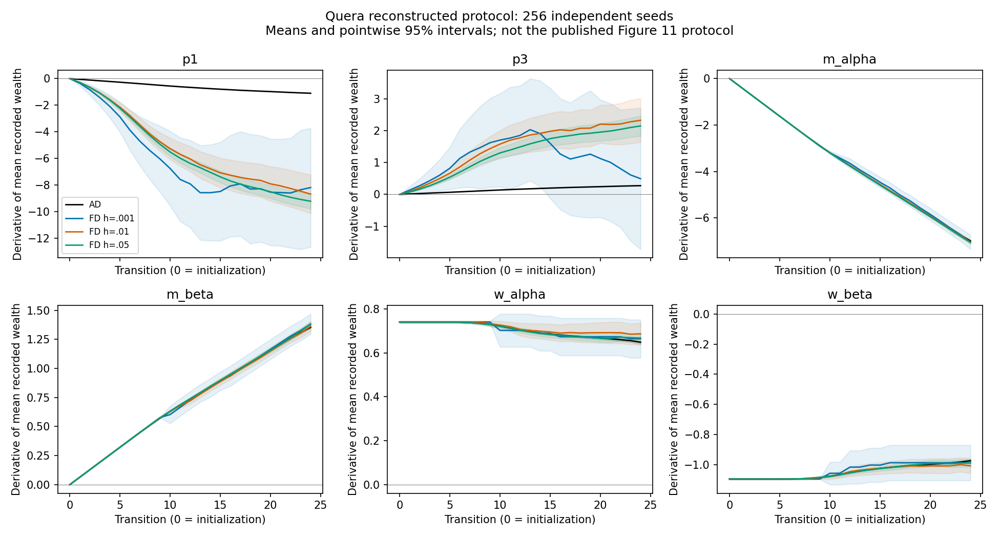
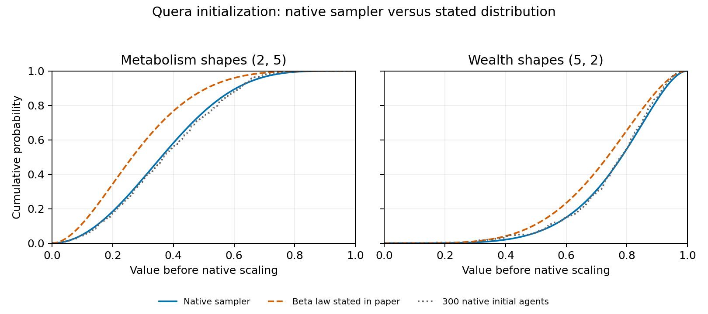

# Quera-Bofarull et al. (2025): Automatic Differentiation of Agent-Based Models

[Native training archive qualification](results/training-archive-qualification-2026-10-20) preserves all fifteen files from the completed three-epoch pathwise run. Fresh remote readback verifies every archive member against the optimizer audit. Full 5,000-epoch archives remain pending; no new simulation coverage or completion credit is added.

[Both native calibration trainers qualify](results/native-training-qualification-2026-10-20): pathwise and VarGrad each pass three full epochs, independent AdamW replay, and validation checkpoint checks. The missing prior and validation settings are explicitly reconstructed. A sequential 5,000-epoch-per-estimator campaign is admitted locally; full calibration remains incomplete.

[Coupled calibration qualification](results/calibration-adapter-qualification-2026-10-20) identifies a random-realization mismatch in the original value/Jacobian adapter. A separate corrected adapter passes independent two-channel loss and six-gradient checks; prior seed-zero trajectories remain byte-identical. The reconstructed dependency environment and correction are explicit. Full optimization and posterior comparisons remain incomplete.

**Status: incomplete.** Three calibration pilots and all 256 gradient-baseline trajectories pass independent state replay. The paper’s gradient and calibration results remain unreplicated.

Paper: https://arxiv.org/html/2509.03303v2
Author implementation: https://github.com/arnauqb/DiffABM.jl/tree/9178eccd56dd352e3515e276239654239f8d3b41

## Native execution and evidence

We use the author’s `jmlr_submission` revision and its unchanged 348-package manifest with Julia 1.11.3. No model correction is applied. The Sugarscape implementation matches the prepublication revision inspected in the program source audit.

The calibration configuration uses 100 agents, a 25×25 landscape, vision 1/6 with probabilities 0.2/0.8, metabolic parameters 2/5, wealth parameters 5/2, and regeneration 1. Calling the author’s `abm_run` with 50 stored states executes 49 transitions. Seeds are 0, 1, and 2. Gaussian smoothing is 1; the gradient horizon is 10,000. These forward runs do not exercise differentiation.

The retained pilot contains 150 states, 15,000 agent observations, and 93,750 cell observations. The independent Python audit verifies hashes, shapes, ordering, finite values, initial ranges, resource bounds, and survival transitions. It does not independently replay movement.

| Seed | Final population | Initial duplicate positions | Nonpositive post-metabolism wealth while alive | Positive wealth after harvest but died |
|---|---:|---:|---:|---:|
| 0 | 75 | 6 | 25 | 1 |
| 1 | 78 | 11 | 22 | 0 |
| 2 | 75 | 8 | 27 | 1 |

All 14,700 survival transitions match prior-step wealth, as the source implements. This explains the 74 nonpositive-wealth survival observations. Initial positions are sampled with replacement. Occupancy-count discrepancies are recorded separately; they are not automatically interpreted as movement violations. These findings concern source behavior, not a validated negative replication of the paper.

`results/native-pilot-2026-10-17` contains the original runner, command receipt, exit receipt, output hashes, full compressed trajectories, and audit. The top-level runner only replaces the original absolute project/output paths with command arguments. Its scientific configuration is unchanged.

## Reproduce

Obtain the pinned DiffABM checkout above and Julia 1.11.3. Use an isolated Julia depot. Instantiate the checked-in Project/Manifest without updating dependencies:

```sh
julia --startup-file=no --project=/path/to/DiffABM -e 'using Pkg; Pkg.instantiate(;allow_autoprecomp=false); using DiffABM'
julia --startup-file=no --project=/path/to/DiffABM replications/quera_2025/run.jl /path/to/DiffABM /new/output/path
python3 replications/quera_2025/audit.py /new/output/path /new/audit/path
```

To inspect retained evidence, extract `trajectories.tar.gz` into a new directory, copy the retained `run.jl`, `configuration.txt`, and `sha256.txt` there, then run `audit.py`. The archive hash is in `archive.json`. The audit requires a new output directory.

## Remaining paper targets

- Figure 11: automatic-differentiation and finite-difference gradients for six parameters, 100 agents, a 50×50 landscape, and vision 1/3. Recover or explicitly reconstruct the finite-difference step sizes, replicate counts, normalization, seeds, and historical source revision.
- Figures 17, 19b, and 20b: calibration predictive behavior, loss, and posterior. Recover the exact prior and training protocol; reproduce the stated five Monte Carlo samples, 5,000 epochs, validation selection, and flow architecture.
- Extend the three-seed independent movement/resource replay below to calibration and gradient ensembles before assigning broad model-fidelity conclusions.

Program source audits retain the original paper source, digitized vector-figure curves, historical dependency lockfile, and deleted author scripts. The recovered scripts use older configurations and do not establish the paper’s exact experiment protocol. In particular, gradient-figure metadata predates the change from initial wealth `10*sample` to `6+19*sample`; metadata alone does not identify the revision used.

Completion requires quantitative comparisons against these targets and investigation of implementation/configuration errors. This pilot contributes zero completed papers.

## Reconstructed gradient pilot

`results/gradient-pilot-2026-10-17` records full native 25-state trajectories for seeds 0–2, with six-parameter ForwardDiff derivatives and central finite differences at steps 0.001 and 0.01. Each plus/minus pair resets the same seed. The observable is total recorded wealth divided by the initial 100 agents, with no additional time normalization. The model uses the paper’s gradient geometry (50×50, vision 1/3), calibration parameter defaults, and the unchanged submission source.

The independent `audit_gradients.py RUN NEW_OUTPUT` validates all 900 records and recomputes finite differences. Initial wealth derivatives agree within 7.67e-8 at step 0.001. Initial vision/metabolism derivatives are exactly zero. Later estimates differ: the largest per-seed vision difference is 11.55 at step 0.01. These are paired trajectory diagnostics, not converged expectation estimates or a Figure 11 replication.

The first runner attempt failed because separate anonymous functions supplied incompatible ForwardDiff tags. Its source and failure receipt are retained. Using the same function object corrected the runner without changing the simulation or analysis protocol.

The separately declared 256-seed ensemble (seeds 3–258) completed all three steps (0.001, 0.01, 0.05). Its 115,200 records pass the independent audit. Exact published normalization, seed counts, step sizes, and historical source remain unresolved.

## Expectation-gradient diagnostic ensemble

`results/gradient-ensemble-2026-10-17` preserves all 256 per-seed aggregate trajectories, source, protocol, hashes, exit receipt, independent audit, pointwise intervals, and plot. Execution took 125.2 seconds on one local Julia thread. `analyze_gradients.py RUN AUDIT_JSON NEW_OUTPUT` computes paired differences across seeds, Student-t 95% intervals, and separate means for each 128-seed half. These intervals are pointwise and do not establish simultaneous coverage or a whole-paper verdict.

At transition 24, step 0.01 gives:

| Parameter | Mean AD | Mean FD | Paired AD−FD 95% interval |
|---|---:|---:|---|
| p1 | -1.09945 | -8.66722 | [6.12128, 9.01426] |
| p3 | 0.27486 | 2.32484 | [-2.73826, -1.36170] |
| m_alpha | -6.99431 | -7.03762 | [-0.03640, 0.12302] |
| m_beta | 1.35341 | 1.36251 | [-0.05021, 0.03200] |
| w_alpha | 0.64803 | 0.68633 | [-0.08695, 0.01034] |
| w_beta | -0.97236 | -1.00543 | [-0.01652, 0.08265] |

Vision discrepancies persist at step 0.05. The p1 FD means in the two halves are -9.29055 and -9.11920 at that step, versus -6.51086 and -9.84205 at step 0.001. The smallest step has greater uncertainty. Continuous-parameter differences are smaller; several pointwise intervals exclude zero at step 0.05, so this is not evidence of exact equality or unbiased AD.



This broadly agrees with the paper’s qualitative distinction between continuous and categorical gradient quality. It does not quantitatively reproduce Figure 11: historical wealth scaling, observable normalization, and exact experiment settings remain unresolved. No new completed-paper credit is assigned.

To reproduce the retained analysis, verify `sha256.json`, extract `trajectories.tar.gz` into a new directory, and copy `protocol.json` and `exit.json` there. Run `audit_gradients.py`, then `analyze_gradients.py` with that audit. Plot using `plot_gradients.py COMPARISON_JSON OUTPUT_PNG`. Analysis uses SciPy; plotting uses Matplotlib.

## Ordinary-versus-differentiated trajectory control

A strict equality check on aggregate mean wealth failed by at most 2.14e-14 across three seeds. The failure and original runner are retained. A full-state follow-up found **405,000 exactly identical values** across all six histories: resources, x/y positions, individual wealth, survival, and occupancy. Thus the observed aggregate discrepancy arises during reduction, not from changed state trajectories in these three seeds. All 450 derivatives also match the earlier pilot exactly.

`results/gradient-primal-control-2026-10-17` contains both complete histories and receipts. Extract `full-states.tar.gz` and run `julia --startup-file=no replications/quera_2025/verify_primal_states.jl EXTRACTED_DIRECTORY`. This verifier uses only Julia’s Serialization standard library, independently reloads both histories, and requires exact equality. It does not infer state equality for the separate 256-seed ensemble.

## Recovered calibration flow dependency

The author’s [PyTorchNormalizingFlows.jl repository](https://github.com/arnauqb/PyTorchNormalizingFlows.jl/tree/01438e4c95c3f924704eb85945950c6a03ab8502) supplies the separate Julia/Python flow wrapper.
Its UUID matches the dependency in the BlackBIRDS submission Project file.
The flow implementation was last changed in commit `3ac0bac7a80e45544e4982ebd882d784a2386a4d` on March 16, 2025.
The pinned repository head also contains later CI-only changes; it is not claimed as the paper’s exact runtime revision.

Its masked autoregressive constructor creates two blocks per layer, followed by `LULinearPermute`, with a diagonal Gaussian base.
Calling it with six dimensions, four layers, and 32 hidden units matches the paper’s stated architecture.
The author’s ordinary-normal inference workflow completed unchanged in an isolated Julia depot; all 18 checks passed (see validation below).
[The launch manifest](results/flow-recovery-2026-10-17/manifest.json) retains source and lockfile hashes.
Python Torch 2.6.0 and normflows 1.7.3 are explicit reconstruction choices; the author’s CI installs these packages without version pins.
This establishes wrapper execution, but does not establish Sugarscape calibration.

Several settings still prevent a faithful paper-calibration claim:

- The appendix states AdamW, beta values 0.9/0.99, unit-gradient normalization, five Monte Carlo samples, 5,000 epochs, and MMD sample size two.
- The released BlackBIRDS callback selects the highest reported training ELBO; its interface contains no separate validation-data evaluation.
- The paper selects the lowest validation loss across epochs, so the released callback cannot silently stand in for that procedure.
- Exact Sugarscape prior support, learning rate, weight decay, validation construction, and loss-kernel configuration remain unrecovered.

Recover or explicitly declare these choices before fitting; a convenient alternative prior or stopping rule cannot establish the published posterior result.

## Independent movement, resource, and occupancy replay

[The independent replay](results/movement-replay-2026-10-17/audit.json) reconstructs 14,700 agent updates and 91,875 cell updates from the three calibration-configuration pilots.
A passive Julia trace records activation order and initial metabolic/vision parameters while retaining the native step body.
All six agent/cell trajectory CSVs match the original uninstrumented pilots byte-for-byte.

The Python replay checks that each realized live destination maximizes the native masked score, then reconstructs harvesting, metabolism, prior-wealth survival, occupancy, and regeneration.
Every reconstructed state matches exactly, with maximum absolute error zero across all three seeds.
This is a replay of realized choices; it does not reproduce the random tie-selection probabilities.

Across 13,316 live-agent moves, seven land outside the vision mask.
Every such choice occurs when all candidate scores are zero.
Because unavailable cells receive zero rather than exclusion, they can tie with allowed cells and be selected.
One of these seven destinations is already marked occupied.
The report retains each transition, agent, origin, destination, mask value, score, and occupancy.
These are verified behaviors of the pinned release, not yet a paper-level negative verdict or a corrected model.

The native trace archive was read back and compared with every source file.
Reproduce the audit with:

```sh
python replications/quera_2025/replay_movement.py \
  /path/to/extracted-native-trace \
  /path/to/original-forward-pilot \
  /new/replay-audit
```

The original forward pilot is retained in `results/native-pilot-2026-10-17`; its earlier archive remains unchanged.

## Author flow workflow executed successfully

[The recovered wrapper’s unmodified test suite](results/flow-validation-2026-10-17/validation.json) exits zero after 278.1 seconds, including dependency setup.
All 18 existing author checks pass: flow sampling/densities, Zygote derivatives, and the complete normal-data inference workflow.
The latter executes 1,000 optimization iterations and checks posterior sample means against true mean 0.5 and scale 2.0 with tolerance 0.25.
Both posterior checks pass; the original workflow does not export its posterior samples.
The full raw log and terminal receipt are retained, and every recorded source/project/manifest hash remains unchanged.

This establishes an executable Julia–PyTorch flow and inference path with the declared runtime versions.
It does not validate the missing Sugarscape prior, validation selection, 5,000-epoch calibration, or historical Python dependency versions.
The calibration fidelity gaps above remain open.


## Quantified initialization-law discrepancy

The pinned `DiffBeta` implementation samples
`X = (1 - U^(1/b))^(1/a)` for uniform `U`.
Its cumulative distribution is `1 - (1 - x^a)^b`, and its moments are `E[X^r] = b B(1+r/a, b)`.
This differs from the Beta distribution named in the paper.

[The initialization analysis](results/initialization-law-2026-10-17/analysis.json)
holds the native offsets and scales fixed to isolate the distribution choice:

| Parameter | Shapes | Native expected value | Beta expected value with same scaling |
|---|---|---:|---:|
| Metabolism (`2 + 2X`) | 2, 5 | 2.738817 | 2.571429 |
| Initial wealth (`6 + 19X`) | 5, 2 | 20.393939 | 19.571429 |

On a 100,001-point unit grid, maximum cumulative-distribution differences are 0.204684 and 0.115814 respectively.
[Independent R integration](results/initialization-law-2026-10-17/independent-audit.json)
verifies moments and reference distribution values in 2,014 comparisons, with maximum error 1.09e-12.
The analysis checks source revision, clean tracked files, trace configuration, and all six input CSV hashes.
Observed initialization means across 300 agents from the three validated native trajectories are 2.754051 and 20.310633.
These observations are descriptive; no statistical rejection or calibrated-posterior claim follows.



`analyze_initialization.py SOURCE TRACE NEW_OUTPUT` reproduces the analysis from the retained movement traces.
The native sampler remains unchanged. Its effect on the paper’s calibration comparisons still requires investigation.

## Refreshed calibration-source search

[The source inventory](results/calibration-fidelity-2026-10-17/audit.json) records freshly
fetched main/submission revisions for DiffABM and BlackBIRDS. DiffABM's author-opened
[issue to add a Sugarscape training example](https://github.com/arnauqb/DiffABM.jl/issues/3)
remains open, without comments. The repository has no release assets supplying an
experiment package. This supports a specific missing-artifact finding, not a claim
that no implementation exists elsewhere.

The paper source references figure filenames containing
`calibration_sugarscape_w_0.0001_lr_0.0005`. This suggests a learning-rate value of
0.0005, but filenames do not establish the optimizer configuration or the meaning
of `w`. In particular, `w` is not evidence of optimizer weight decay. The appendix
still omits the exact prior, loss-kernel settings, and validation-data construction.
These hints do not justify labeling a reconstructed calibration as the paper's run.

## Full gradient-baseline movement replay

[All 256 original diagnostic seeds](results/gradient-movement-replay-2026-10-18) pass independent replay of 614,400 agent updates and 15,360,000 cell updates with zero state error. Passive tracing preserves all native state hashes and matches every retained aggregate baseline record.

The trace records 4,020 outside-mask moves and 223 moves to cells marked occupied; all occur at zero-score ties. Every seed contains an outside-mask move. This extends the source-behavior finding beyond the three calibration pilots. Perturbed trajectories and the paper’s missing calibration protocol remain separate requirements. The full differentiated-baseline control below extends this replay to differentiated baseline states.

## Complete differentiated-baseline state control

[All 256 seeds](results/gradient-state-control-2026-10-18) produce exactly equal ordinary and differentiated states across 34,560,000 values. Independent readback also matches the earlier movement trace and all 38,400 derivatives against 115,200 archived records.

A failed aggregate-equality assumption exposed 4,632 differences no larger than 3.20e-14. The verifier reproduces both totals exactly using their respective reduction orders; no tolerance was fitted. This validates the diagnostic baseline, while exact published experiment settings and calibration remain unresolved.

## Perturbed gradient trajectory replay

[The complete seed-3 qualification](results/perturbed-movement-qualification-2026-10-18) validates all 36 parameter/step/sign cases. Native passive-state hashes and all 900 archived plus/minus aggregate values match exactly. Independent replay checks 86,400 agent updates and 2,160,000 cell updates with zero state error. All 256 previous baseline results also reproduce exactly. The disjoint remaining seeds 4–258 have now completed; the complete audit is described below.

The trace command now requires an explicit profile and inclusive seed bounds, and writes compressed CSVs:

```sh
julia --startup-file=no --project=DIFFABM trace_gradient_movement.jl DIFFABM NEW_TRACE ORIGINAL_GRADIENT_ENSEMBLE perturbed 3 258
python replay_movement.py NEW_TRACE ORIGINAL_GRADIENT_ENSEMBLE NEW_AUDIT --profile gradient-trace
```

Use `baseline` instead of `perturbed` for unperturbed cases. The auditor preserves its existing `gradient-ensemble` profile for retained historical uncompressed evidence. Neither profile establishes the paper's missing experiment settings or calibration result.

## Complete perturbed trajectory replay

[All 9,216 diagnostic cases](results/perturbed-movement-complete-2026-10-18) now pass independent replay: 256 seeds × six parameters × three finite-difference step sizes × two directions. The 36 qualification cases and 9,180 continuation cases are disjoint and exhaust this declared grid. Replay verifies **22,118,400 agent updates and 552,960,000 cell updates with zero state error**.

The continuation exited zero in 866.5 seconds; its separate replay also exited zero. Compressed per-case audits, native manifests, passive parity records, executed Julia source, Python auditor and exact commands are retained. The 1.91 GB native trace upload exited zero. The remote checksum manifest matches local bytes; complete individual-object readback is documented below.

This validates the reconstructed diagnostic trajectories. It does not recover Figure 11’s historical experiment settings or the missing prior/loss/validation configuration and 5,000-epoch calibration. No whole-paper completion is claimed.

## Published calibration-loss coordinates

[The figure extraction](results/calibration-loss-figure-2026-10-19/audit.json) recovers
7,549 displayed vertices from the four loss paths in Figure19(b).
The Figure19 caption identifies faint paths as raw iteration losses and solid paths as moving averages.
The averaging width and exact training/validation objective remain unspecified.
All four paths span iterations0–2999, whereas the appendix specifies5,000 training epochs.
This establishes a displayed-range discrepancy, not early stopping or a failed scientific result.
The legend reports best losses−175.0 and−172.0; their selection procedure remains unresolved.

MuPDF and Poppler/Cairo agree geometrically within0.002743 PDF points.
Cairo omits one vertex in three paths, so exact vertex-count equality was an invalid audit assumption.
The failed extractor is preserved in external evidence and hash-recorded in `verification.json`.
The revised audit checks both directions against the complete polylines; a second extraction reproduces all outputs byte-for-byte.

Run `pdftocairo -svg FIGURE.pdf FIGURE.svg`, then
`python extract_calibration_loss.py FIGURE.pdf FIGURE.svg NEW_OUTPUT` with PyMuPDF installed.
The figure is the `figures/results_calibration/calibration_sugarscape_w_0.0001_lr_0.0005_elbo.pdf`
member of the [v2 paper source](https://arxiv.org/src/2509.03303v2); its hash is pinned in the audit.
These simplified plot vertices are comparison targets, not recovered raw loss records or completed calibration.


## Complete calibration figure plan

[The gated renderer](results/calibration-figure-plan-2026-10-20) covers posterior predictive trajectories, joint parameter samples, and complete training histories.
It waits for both 5,000-epoch audits, all 4,000 predictive trajectories, and independent R arithmetic before consuming those outputs.
It verifies input hashes and retains all 1,000 samples per distribution.
Predictive bands are pointwise empirical 95% intervals, not simultaneous coverage.
Parameter panels use empirical cumulative distributions and scatterplots without density smoothing; five independent coordinates omit the redundant probability p6=1-p1.
Training and validation objectives are shown separately, unsmoothed, across all 5,000 epochs.
These are declared display choices, not recovery of the historical plot settings.

R syntax and Python lint checks pass. Rendering and visual inspection remain pending; no calibration result or completion credit is inferred.


## Full pathwise calibration and precision audit correction

[The first complete calibration arm](results/pathwise-full-calibration-2026-10-20) finished all 5,000 epochs without changing the frozen training method.
Independent replay checks 95,570,000 optimizer components and 25,000 validation draws.
The maximum optimizer difference is 2.991e-8, within the original unchanged tolerances.
The fixed validation rule selects epoch 413, with loss −128.47138168836435.
This reconstructed validation objective is not directly comparable to the paper’s plotted best losses.

The original auditor failed at epoch 4 because it compared a native Float32 gradient norm against Float64 arithmetic within two parts per million.
All 5,000 recorded norms reproduce exactly with the pinned Julia Float32 runtime.
Their largest Float64 difference is 6.923 parts per million.
The corrected auditor uses those independently verified native norms and reconstructs exported Float32 values before Float64 optimizer replay.
Optimizer acceptance tolerances remain `rtol=2e-6, atol=2e-7`.
Separate corrupted norm and epoch-log controls both fail; original outputs, failed auditor, and failure log are retained.
This corrects validation arithmetic; it does not modify simulation, training, checkpoint selection, or tune agreement with the paper.

All 15,006 native files were sealed into 11 archives totaling 781,500,746 compressed bytes.
Fresh remote downloads match every archive and every native member against the full audit.
The manifest, object keys, hashes, amendment, norm replay, and audit are retained here.
The previously unstarted VarGrad arm resumed with unchanged sources and seeds; its first three epochs match qualification byte-for-byte.
VarGrad completion, posterior prediction, and whole-method assessment remain outstanding.

Reproduce validation with the recorded Julia runtime and NumPy environment:

```sh
julia --startup-file=no replay_norms.jl NATIVE NATIVE/epochs.csv NEW_NORMS.csv
python audit_training_native_norms.py NATIVE NEW_AUDIT.json NEW_NORMS.csv
python seal_training.py NATIVE NEW_AUDIT.json NATIVE_EXIT.json 5000 NEW_ARCHIVES
```


## Complete perturbed trace storage readback

[Fresh remote readback](results/perturbed-storage-readback-2026-10-20) verifies all 36,724 objects, totaling 1,908,595,493 bytes, against the pinned manifest.
The 36,720 trace files cover exactly the 9,180 continuation cases already checked by independent state replay.
The final audit rehashes the complete downloaded set and checks exact case coverage.
Earlier interrupted downloads remain preserved; transition audits confirm previously verified files retained their hashes, sizes, and modification times.
This closes the remote evidence verification gap without rerunning simulations or adding study completion credit.


## Full VarGrad calibration

[The second complete arm](results/vargrad-full-calibration-2026-10-20) finished 5,000 epochs in 2,295.48 seconds with unchanged frozen sources and seeds.
All 5,000 native Float32 norms reproduce exactly; independent replay verifies 95,570,000 optimizer components and 25,000 validation draws.
The maximum optimizer difference is 2.987e-8 under the unchanged acceptance tolerances.
The fixed validation rule selects epoch 105, with loss 27.820718920231442.
Both arms started from identical parameters; their first three epochs also preserve their respective qualification outputs exactly.

Fresh remote readback verifies all 15,006 native files from the second arm.
Both arms now have complete optimizer, checkpoint-selection, and storage evidence.
These checks validate the declared reconstructed optimization; they do not establish historical numerical agreement or whole-study completion.
The predictive comparison and final method assessment remain separate requirements.
