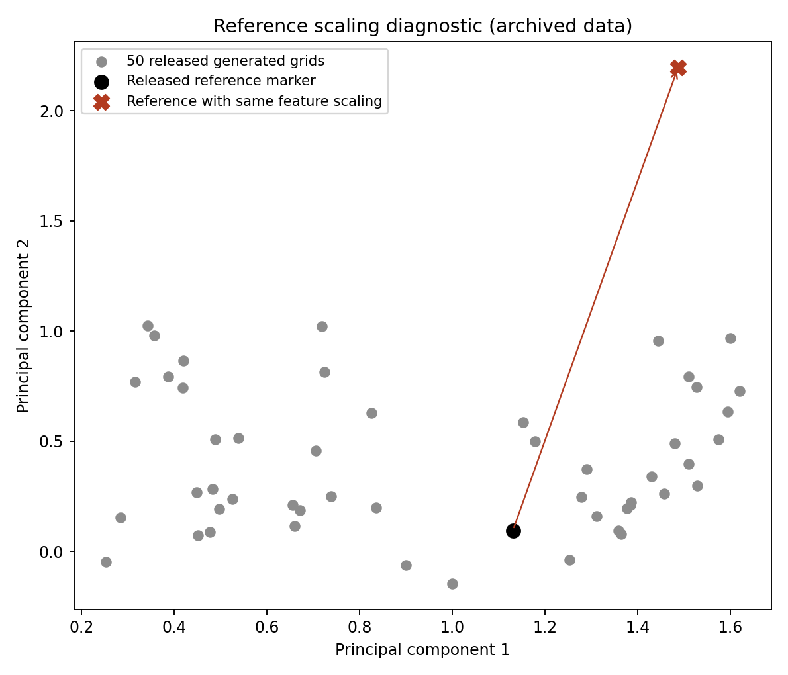

# Raimbault et al. (2019): Space Matters

Paper: [Space Matters: Extending Sensitivity Analysis to Initial Spatial Conditions in Geosimulation Models](https://www.jasss.org/22/4/10.html).
Scope: Sugarscape results; Schelling experiments are excluded.
Status: **24/24 Table 4 values reproduced from archived data; all55,000 fixed-reference inputs replayed; generated-landscape ensemble remains unfinished**.
This is not yet a completed paper replication.

## Sources and exact reanalysis

Author code: [JusteRaimbault/SpaceMatters](https://github.com/JusteRaimbault/SpaceMatters),
revision `270cc7f112b3a999b10e02b0f9525038d6d4754d`.
Data: [Harvard Dataverse, doi:10.7910/DVN/9JI57U](https://doi.org/10.7910/DVN/9JI57U), CC0-1.0.
The embedded NetLogo model has a separate CC BY-NC-SA 3.0 notice; the dataset license does not replace it.

The independent Python analysis follows the authors' `distancesToRef` definition:
twice the squared Minkowski distance divided by the sum of sample variances of the two phase diagrams.
Reference Gini values are averaged across replicates before comparison.
Missing grid/parameter combinations are excluded from the paired comparison, as in the released R code;
every exclusion is counted in the result manifest.

All six summaries at each of q=1,2,3,10 match Table 4 at published precision.
The Euclidean mean, median, minimum, and maximum are 1.29594, 1.52272, 0.08909, and 2.98273.
[Full comparisons and coverage](results/archive-2026-10-15/results.json) preserve every grid distance and input hashes.

Run with Python and NumPy 1.26.4:

```sh
python3 replications/raimbault_2019/fetch_sources.py --output /absolute/new/data
python3 replications/raimbault_2019/analyze_archive.py \
  /absolute/new/data/reference.csv /absolute/new/data/generated.csv --output /absolute/new/analysis
```

The downloader verifies immutable file contents against `sources.json`.
The approximately 30 MB source data remain in the chosen directory instead of being duplicated in the Git repository.

## Design details requiring fidelity

The archived reference contains 55,000 simulations: 1,100 parameter combinations with 50 repeats each.
Population takes 11 values (10 through 510 in steps of 50), not the ten bins described in the paper.
The generated-grid archive contains 54,560 aggregated combinations across 50 grids, rather than a complete 55,000.
Thirty-two grids have all 1,100 points; fourteen lack 20 points each, and four lack 40 each.
These facts explain the source dimensions; they do not themselves establish an incorrect substantive conclusion.

The `.source` file for the fixed reference includes an incorrect link to the generated-grid data.
The correct fixed-reference artifact is Dataverse file 3596481, persistent identifier `doi:10.7910/DVN/9JI57U/NIJ2BN`.
Its original CSV format is fetched explicitly.

The NetLogo model replaces dying agents, so population remains fixed while wealth evolves.
The current model averages Gini over the last 1,000 steps; its configured run length is also 1,000.
Historical revisions ran 10,000 steps, so the archive horizon needs verification.
Model setup also draws continuous metabolism and sugar endowments, with integer vision and lifetime.
The released OpenMOLE script requests 100 repeats, whereas the archived reference has 50.
New runs must follow the validated experiment rather than silently using a mismatched current script.

## Fresh simulation pilot and provenance investigation

The first archived reference input completes 1,000 steps with constant population under NetLogo 5.3.1.
Its terminal Gini is 0.3942307692 versus archived 0.2445487365.
Its moving-window Gini is 0.2939769248 versus archived 0.3017667641.
[Trajectory and comparison](results/replay-pilot-2026-10-15/comparison.json) retain this unresolved mismatch.
**This was a horizon mismatch, not a negative replication.** The 10,000-step replay below resolves this input.

The archive filename is dated March 28, 2017; that date does not prove which revision generated its contents.
Commit `b71d1cf73f036749a83335b6a13cabf345599039` added explicit seeding and corrected resource initialization on April 3, 2017.
Commit `74ade6eaa77af4caa65183a2eba6a3ded4708e0f` changed the horizon from 10,000 to 1,000 on September 27, 2018.
The model header identifies NetLogo 5.1.0, while this pilot uses 5.3.1; the original execution runtime remains unverified.
The historical horizon is confirmed for the first input by exact replay; additional input checks remain in progress.

The Java adapter invokes the released setup and records each step without editing the model.
Place `NetLogo.jar` before the wildcard classpath: `NetLogoLite.jar` otherwise shadows full workspace classes in this installation.
The initial compilation failure is preserved with the successful execution log.

```sh
/path/to/jdk/bin/java -Djava.awt.headless=true \
  -cp '/path/to/netlogo/app/NetLogo.jar:/path/to/netlogo/app/*' \
  replications/raimbault_2019/Replay.java \
  /path/to/SpaceMatters/sugarscape/HEADLESS_Sugarscape.nlogo \
  /path/to/reference.csv 0 10000 /absolute/new/trajectory.csv
```

Run from the author model directory, using absolute paths for the adapter and artifacts.
The adapter requires an explicit choice between the two documented horizons, 1,000 and 10,000 steps.
It changes only `total-time-steps` after the released setup and records every simulated tick.

## Historical horizon validated

At 10,000 steps, the first archived input reproduces terminal Gini **0.24454873646209388**
and last-1,000-step mean Gini **0.3017667640537167**, both exactly equal to the archive's recorded NetLogo outputs.
Independent Python recomputation of the window mean differs by 2.22e-16 from NetLogo's summation.
The first 1,000 trajectory rows are identical to the earlier pilot.
[Raw trajectory, execution log, and comparison](results/horizon-validation-2026-10-15) preserve the successful replay.
Thus the initial mismatch is explained by the later horizon change, without changing seed, behavior, parameters, or runtime.
Rows 1 and 54,999 also reproduce both archived NetLogo Gini outputs exactly.
[Additional comparisons](results/horizon-validation-2026-10-15/additional-comparisons.json) include complete trajectories and independently recomputed window means.
These three inputs validate the corrected replay path; they do not complete the spatial ensemble.

## Remaining work

1. Run the original NetLogo 5 model and morphology extension against archived seeds.
2. Validate and implement the study-specific simulation behavior in this fork.
3. Recreate the spatial layouts, reference ensembles, and generated-grid ensembles with declared uncertainty criteria.
4. Reproduce the phase-diagram contrasts and distance summaries from fresh simulations.

Archived-data reanalysis alone does not satisfy these simulation requirements.

## Full fixed-landscape reference replay

`run_reference.py ENGINE NETLOGO JDK REFERENCE_CSV NEW_OUTPUT` runs all 55,000 archived reference inputs at 10,000 steps each.
It pins the author revision and original dataset hash, records model/runtime/dependency hashes, and preserves native exit status.
The adapter flushes each completed row with its seed, population, horizon, terminal Gini, and moving-window Gini.
It checks fixed population at every simulated step and rejects incomplete or nonfinite runs.
Full per-step trajectories remain available from `Replay.java`; the ensemble retains the two native measurements used in the source archive.

The headless setup creates turtles without clearing the previous run.
`BatchReplay.java` explicitly clears the workspace before each original seeded setup, preventing cross-run population contamination.
It does not edit the author model or change the historical 10,000-step rule execution.
[The three-row batch pilot](results/batch-pilot-2026-10-15/comparison.json) completes 30,000 steps and matches all six archived native Gini measurements exactly.
The full 55,000-input replay is now running. Generated-grid ensembles and fresh spatial contrasts remain required afterward.

## Independent reference audit

`audit_reference.py REFERENCE_CSV RUN prefix|complete NEW_OUTPUT` reads the original hashed archive independently of the runner's copied comparison columns.
It checks row order, original seeds, population, full horizon, finite measurements, source hashes, and both native Gini values.
Complete mode requires a successful native exit and every row in the requested interval.
Only an interval covering all 55,000 rows sets `complete_reference` to true.
Prefix mode saves an immutable snapshot and never represents a completed ensemble.

[The first audited prefix](results/reference-prefix-2026-10-15/audit.json) contains 15 simulations and 30 exact native measurement matches.
A deliberately altered copy of one Gini value is rejected with exactly one reported mismatch; this negative control is labeled separately from scientific results.
The full reference continues running. This prefix does not establish parameter-space coverage or the generated-landscape conclusions.

## Interrupted reference recovery

The first full replay stopped without a recorded exit status. Its cause is unknown.
An [independent audit](results/process-recovery-2026-10-16/recovered-audit.json) validates all 2,399 preserved rows: 4,798 exact native Gini matches.
The original directory and partial execution log remain intact.

The runner accepts `--start ROW --stop ROW` with an exclusive stop, using the original archive row indices.
A fresh two-row run spanning the restart boundary reproduces all four archived measurements exactly.
[Its complete interval audit](results/process-recovery-2026-10-16/resume-proof-audit.json) explicitly reports that the full reference remains incomplete.
The continuation starts at row 2,399 and requests the remaining 52,601 rows in a new directory.
The two-row validation overlaps the continuation and must not count as additional ensemble coverage.

## Partitioned continuation

The sequential continuation was deliberately stopped after 847 additional validated rows.
Together, the preserved runs cover original indices `[0,3246)` with 6,492 exact native measurement matches.
The remaining inputs run in five disjoint intervals using the same adapter, seeds, model, and 10,000-step horizon.
Their requested intervals cover `[3246,55000)` without gaps or overlaps.

[Initial independent audits](results/sharded-reference-2026-10-16/coverage.json) validate another 72 rows across all five processes, with zero measurement mismatches.
Total unique audited coverage is 3,318 of 55,000 inputs; gaps remain between these partial shard outputs.
The launch manifest, preserved sequential prefix, and five immutable snapshots retain the partition boundaries and exact evidence.
Neither partitioning nor matching partial outputs completes the paper replication.

## Later shard audit

[The second shard snapshots](results/shard-progress-2026-10-16/coverage.json) validate 2,175 completed simulations across the five processes, with zero mismatches.
Together with the preserved contiguous prefix, unique audited coverage is 5,421 of 55,000 inputs: 10,842 exact native Gini measurements.
These snapshots supersede the earlier shard snapshots for coverage counting; overlapping rows are counted once.
The processes continue. Fixed-reference completion and generated-landscape conclusions remain pending.

## Machine-crash recovery

All five old shard processes were absent after the machine restart. Their complete saved prefixes passed independent audits with zero mismatches.
The original contiguous prefix plus these preserved shard outputs cover 5,773 unique inputs.
Fresh directories resume the remaining original intervals at indices 4,445; 14,077; 24,282; 34,589; and 44,874.
No saved completed row is rerun or dropped. Seeds, adapter, model, horizon, and memory limits are unchanged.

[Initial resumed-prefix audits](results/crash-recovery-2026-10-16/coverage.json) add 13 exact matches across all five workers.
Total unique audited coverage is 5,786 inputs and 11,572 native Gini measurements, with zero mismatches.
Immutable saved and resumed snapshots, their checksums, and launch commands are retained. The full reference and generated-landscape studies remain incomplete.

## Resumed-prefix validation

[Five fresh snapshots](results/resumed-prefix-2026-10-16/coverage.json) independently validate 193 resumed inputs, including 180 beyond the recovery snapshot.
Both Gini measurements match exactly for every input.
Replacing the earlier overlapping prefixes gives 5,966 unique validated inputs and 11,932 exact measurements.
Compressed native snapshots, hashes, and disjoint interval accounting are retained.
All five workers remain active; the full 55,000-input reference and generated-landscape study remain incomplete.

## Linux portability and bounded CPU handoff

[Three full-horizon portability probes](results/linux-parity-2026-10-16/comparison.json) reproduce rows 0, 1, and 54,999 on Ubuntu 22.04 with Java 11.0.32.1.
All six native Gini values match the archive exactly; result CSVs are byte-identical to the macOS package proof.
The downloaded archive was checksum-verified and compared independently against the original reference CSV.
These repeated validation rows add **zero** unique ensemble coverage.

The first packaging attempt omitted three nested `.nls` files and failed before simulation.
Recursively including those unchanged author sources fixes packaging; model rules and parameters remain unchanged.
The retained Linux artifact includes manifests, dependency hashes, source hashes, raw results, native logs, and complete interval audits.
Probe timings are retained for capacity planning, but concurrent machine workloads prevent a controlled speed comparison.

After parity passed, the owned local fifth shard was deliberately terminated and its exit confirmed.
Its 142 completed rows, `[44874,45016)`, passed an independent audit with 284 exact measurements.
Local execution resumes `[45016,54600)` in a new directory.
Eight remote workers receive disjoint 50-row intervals covering `[54600,55000)`.
[The handoff record](results/linux-parity-2026-10-16/handoff-confirmed.json) preserves the terminal checkpoint and commands.
The remote batch is bounded to one hour and stops its CPU node afterward; its results remain pending and uncounted here.
The full reference, generated landscapes, and paper replication remain incomplete.

## Generated-landscape source and executable replay

The [original per-run archive](https://dataverse.harvard.edu/api/access/datafile/3596486?format=original)
contains 1,180,976,826 bytes and matches Dataverse's MD5 `7b554774a9d293b2c2ce3169c9d48dbe`.
Its SHA-256 is `1a2cdf93167571ab2943d488017ace08945e7afd3cd8ac4d1410fb214c79c8f5`.
The source remains outside Git, compressed losslessly; replay verifies the decompressed hash before execution.

[Full archive reconstruction](results/generated-source-2026-10-16/raw-audit.json) verifies **2,727,994 runs** across 54,560 parameter groups and 50 landscape parameter sets.
There are 54,554 groups with 50 repeats and [six groups with 49](results/generated-source-2026-10-16/underfilled-groups.json).
No group repeats a seed. All rows request generated landscapes (`setup=1`).
All 54,560 reconstructed moving-window Gini means agree with the released aggregate within 8.33e-16.
The five averaged generator parameters agree within 1.01e-11; the audit's explicit aggregate tolerance is 1e-10.
This validates the provenance of the aggregate used for Table 4, without substituting reanalysis for simulation.

The author model seeds its random generator before generating each landscape and creating agents.
Therefore, a landscape parameter set identifies a family of seeded maps, not one map reused for every repeat.
The replay preserves every recorded seed and regenerates the corresponding map before running the original agent rules.

`GeneratedReplay.java` streams the gzip archive instead of retaining its 2.7 million rows in memory.
`run_generated.py` pins the model revision, source/dependency hashes, full raw archive, interval, Java version, and exit status.
It records both Gini metrics and all ten native spatial morphology outputs at the validated 10,000-step horizon.
The existing fixed-reference runner and its live simulations are unchanged.

```sh
python3 replications/raimbault_2019/audit_generated_archive.py \
  /absolute/generated-raw.csv.gz /absolute/generated.csv /absolute/new/archive-audit
python3 replications/raimbault_2019/run_generated.py \
  /absolute/SpaceMatters /absolute/netlogo /absolute/jdk \
  /absolute/generated-raw.csv.gz /absolute/new/generated-pilot --start 0 --stop 2
```

The first command reconstructs the published aggregate; `generated.csv` is the aggregate from `fetch_sources.py`.
The second command runs the original model through the public runner; row intervals use exclusive stops.

[The two-row generated-landscape pilot](results/generated-source-2026-10-16/pilot-comparison.json) completes 20,000 simulated steps with native exit zero.
Both Gini outputs match exactly for both rows. Across all 24 output values, 23 match exactly.
Row 1's population-distribution R² is `0.8963279972950365`, versus archived `0.8963279972950364`: one floating-point step.
The strict exact comparison fails on that value; its discrepancy is retained, with no relaxed pass criterion.
A repeated execution through the public runner produces byte-identical output.
These validation probes add zero unique ensemble coverage. The full generated ensemble and fresh spatial conclusions remain pending.

## Generated-landscape diversity probes

[Six input-selected probes](results/generated-diversity-2026-10-16/summary.json) cover landscape parameter sets 16 and 23 at populations 10, 260, and 510.
Selection took the first recorded input in each category without consulting output values.
Five inputs are new probes; original row 0 is a repeated control. These probes add zero production-ensemble coverage.
Every run preserves its archived seed, full 10,000-step horizon, native model, and terminal status.

Both Gini measures match exactly for all six inputs. Of 72 output values, 66 match bit-for-bit.
The six deviations occur in regression slope or R², with maximum absolute error 4.44e-16.
Before these runs, the campaign declared exact Gini matching and a 1e-12 absolute tolerance for morphology outputs.
That tolerance was chosen after the initial exploratory discrepancy; it does not change the earlier strict-exact failure.
Every deviation and the original strict comparison remain available in the evidence.

Bytecode inspection traces the regression to the unchanged extension's Apache Commons Math `SimpleRegression` methods.
This identifies the implementation being executed; it does not establish the exact historical cause of floating-point differences.
An independent pass through the original archive verifies all six selected indices and all 72 output comparisons.
The full generated-landscape ensemble and spatial conclusions remain incomplete.

## Remote reference validation and complete checkpoint handoff

[The first remote production batch](results/remote-reference-2026-10-16/batch-400-independent-validation.json) completes original rows `[54600,55000)`.
All 400 runs finish 10,000 steps, and all 800 native Gini measurements match the original archive exactly.
Downloaded evidence verifies successful native exits, row identities, source/dependency hashes, interval completeness, and independent output comparisons.
The node stops automatically after the batch; its files remain intact and were retrieved for the audit.

After that audit, the five owned local reference workers were deliberately stopped and their terminal states verified.
[The consolidated checkpoint](results/remote-reference-2026-10-16/handoff-confirmed.json) independently validates **7,933 unique runs and 15,866 exact Gini measurements**.
Original files remain intact. The retained checkpoint snapshots include all covered rows, manifests, logs, and available terminal records.
Earlier overlapping snapshots and validation probes are excluded; the remote 400-row interval is counted once.

The remaining **47,067 original rows** are assigned to 473 disjoint intervals of at most 100 rows on eight CPU workers.
The queue validates the frozen runtime bundle before execution and audits each completed interval against the original reference.
A native or audit failure prevents pending intervals from starting; already-running intervals preserve their outputs.
The launch wrapper enforces a 24-hour limit, preserves evidence, and stops the task-owned node afterward.
A two-interval native queue proof passed before this handoff; its raw results and audits are retained with the plan.
The production queue is running, so its unfinished outputs are not included in the checkpoint count.

The full 55,000-row reference, generated-landscape ensemble, and paper replication remain incomplete.

## First running-queue checkpoint

[Independent validation](results/remote-reference-checkpoint-2026-10-16/checkpoint-002-independent-validation.json) checks 14 completed chunks covering `[5120,6520)`.
All 1,400 runs finish 10,000 steps; all 2,800 Gini measurements match the original reference exactly.
The downloaded archive retains native outputs, successful exits, manifests, and per-chunk audits.
Independent checks verify original seeds, populations, row identities, source/dependency hashes, and complete disjoint intervals.
These intervals belong to the reserved production plan and do not overlap the earlier 7,933-row checkpoint.
Combined validated coverage is **9,333 of 55,000 reference runs**; unfinished chunks are excluded.
This remains partial reference evidence, not completion of the paper replication.

## Audit fresh generated intervals

`audit_generated.py` checks fresh output against the full, hash-pinned original raw archive.
It verifies source/dependency hashes, requested bounds, original identifiers/seeds/populations, the horizon, and all 12 measurements.
Complete mode requires a successful native exit and every requested row; prefix mode labels partial coverage explicitly.
The audit preserves an immutable output snapshot and records every non-exact measurement, including differences within tolerance.
Gini comparisons always require exact equality. The morphology tolerance must be supplied explicitly and cannot exceed `1e-12`.

```sh
python3 replications/raimbault_2019/audit_generated.py \
  /absolute/generated-raw.csv.gz /absolute/native-run complete /absolute/new/audit \
  --morphology-absolute-tolerance 1e-12
```

[Real two-row workflow evidence](results/generated-auditor-2026-10-16/validation.json) exercises the existing public-runner pilot.
Strict zero tolerance fails on its known R-squared difference; the previously declared `1e-12` morphology tolerance passes.
Both reports retain 23 exact comparisons out of 24, with both Gini metrics exact for each input.
This verifies the audit workflow and adds no simulation coverage or completed-paper claim.

## Linux generated-landscape portability

[Independent downloaded-artifact validation](results/generated-linux-2026-10-16/independent-validation.json) checks all six previously selected probes on the task-owned Linux CPU node.
All three sequential two-row native processes exit successfully, completing the original 10,000-step horizon.
Frozen model, extension, dependency, adapter, input, and criteria hashes are verified before comparing outputs.

**All 72 Linux measurements match the original archive exactly**, including both Gini outputs and all ten morphology outputs for every input.
Linux and macOS agree exactly on 66 of 72 measurements; six regression outputs differ by at most `4.440892098500626e-16`.
Every cross-platform difference remains within the previously declared `1e-12` morphology tolerance; Gini comparisons remain exact.
The original macOS strict-exact failure is preserved and is not relabeled as an exact match.
These observations narrow the numerical discrepancy to differences between the tested runtime environments; they do not isolate OS, architecture, or JDK effects.

The three pairs took 93.41, 318.77, and 457.18 seconds on one low-priority worker sharing the eight-core reference node.
These selected probes are not a representative throughput sample for the 2,727,994-row generated ensemble.
The full generated ensemble and fresh spatial comparisons remain unstarted; these repeated probes add no production coverage.

## Stratified generated-ensemble sizing run

[Input selection](results/generated-sizing-launch-2026-10-16/selection.json) fixes one original input for each of 50 landscape IDs and 11 population levels.
Reservoir sampling uses seed `20261016`, independently within each stratum, before executing the selected runs.
A second full-archive pass verifies every selected field, all original indices, and the stratum counts summing to 2,727,994 runs.
Original stratum sizes will weight timing estimates; an early prefix cannot substitute for the complete sample.

A separate eight-core CPU node runs the 550 selected inputs with a six-hour limit, captures evidence, and stops automatically afterward.
Each native process retains wall time, CPU time, peak memory, commands, outputs, exit status, and all twelve output comparisons.
Native or measurement failures stop pending work; already-running outputs remain intact.
This benchmark leaves the existing fixed-reference queue unchanged.

[Downloaded initial evidence](results/generated-sizing-launch-2026-10-16/prefix-independent-validation.json) independently verifies eight completed inputs and 96 exact archived measurements.
These early inputs establish execution, not a representative cost estimate or completion of the generated ensemble.
The initial snapshot was partial; the complete sizing audit below supersedes it. No full generated-production queue has been launched.

### Independent sizing audit and projection gate

`analyze_sizing.py` validates the frozen input selection, completed native outputs, timings, and output hashes independently of the producer's audit verdicts.
The [223-input snapshot](results/generated-sizing-audit-2026-10-16/analysis.json) matches all 2,676 archived measurements exactly.
This snapshot includes the eight initially reported inputs; the counts are not additive.
Running `--require-complete` against this real snapshot fails before creating output, because 327 selected strata remain absent.

The analyzer emits a projection only when all 550 selected strata have valid results.
It weights CPU time and elapsed time by original stratum size, then reports an ideal eight-CPU estimate and an eight-worker elapsed-time estimate.
A supplied hourly price is an assumption, not a live quote or guaranteed budget.
Both estimates retain per-input Java startup costs and exclude setup, retries, transfer, and idle time.
One sampled input per stratum does not estimate within-stratum timing variance; no confidence interval is claimed.
The complete projection path is now exercised by the full sizing audit below.

```bash
python replications/raimbault_2019/analyze_sizing.py /downloaded/sizing-run /new/sizing-analysis --hourly-node-price 0.4824 --require-complete
```

### Second remote reference checkpoint

The [sealed checkpoint audit](results/remote-reference-checkpoint-2026-10-16/checkpoint-003-independent-validation.json) verifies 53 completed chunks, containing 5,300 original inputs.
All 53 recorded source and dependency files match the frozen local runtime.
Combining these chunks with the 7,933-row local baseline yields 13,233 unique simulations and 26,466 exact archived Gini comparisons.
The earlier 1,400-row cloud snapshot is contained in this checkpoint and is not added again.
The native archive and independent validation script are retained beside the report.
The 55,000-row reference ensemble remains incomplete; this checkpoint makes no generated-landscape or whole-paper replication claim.

### Third remote reference checkpoint

The [71-chunk audit](results/remote-reference-checkpoint-2026-10-16/checkpoint-004-independent-validation.json) verifies7,100 remote inputs against the original reference archive.
Together with7,933 frozen local inputs, coverage reaches15,033 unique simulations and30,066 exact Gini comparisons.
All53 source/dependency hashes match the frozen runtime; every sealed chunk exits successfully and completes its declared interval.
This adds1,800 rows beyond checkpoint003; previous cloud checkpoints are contained here and are not added again.
The55,000-row reference ensemble remains incomplete, and generated landscapes and fresh spatial comparisons remain separate requirements.

### Complete generated-landscape sizing sample

The [complete audit](results/generated-sizing-complete-2026-10-16/analysis.json) validates all 550 selected inputs and 6,600 exact archived measurements.
The retained native archive includes timings, outputs, commands, and frozen selection for independent replay of this audit.
This supersedes the 223-input snapshot; their counts are not additive.

Stratum-weighted timing projects 19,831.91 CPU-hours, or 2,494.73 elapsed hours on one eight-worker node, for all 2,727,994 inputs.
At an assumed $0.4824 per node-hour, the elapsed projection costs $1,203.46.
This includes per-input Java startup and excludes setup, retries, transfer, and idle time.
One observation per stratum provides no within-stratum variance estimate or confidence interval; this is not a guaranteed budget.
The full generated ensemble remains unstarted. Benchmarking repeated inputs within one Java process is a possible next efficiency check, subject to exact-output validation.

### Bounded batched sizing benchmark

The [frozen bootstrap package](results/batched-sizing-launch-2026-10-17/plan.json) partitions the same 550 selected inputs across eight native Java processes.
`GeneratedReplay.java` is unchanged: each input resets the model and its original random seed within a reused workspace.
All 6,600 outputs must match their archived measurements exactly before a successful result is reported.
The simulation limit is one hour; bootstrap setup and execution are bounded separately.
Official NetLogo and Commons Math downloads match the pinned runtime hashes, and every packaged member passes byte-for-byte readback.
The end-to-end bootstrap and eight-process experiment completed successfully; see the full audit below.
This measures sample throughput; batch-level timing does not identify per-stratum CPU costs, so it cannot alone replace the weighted full-ensemble cost projection.

### Fourth remote reference checkpoint

[Independent validation](results/remote-reference-checkpoint-2026-10-16/checkpoint-005-independent-validation.json) checks 197 sealed chunks containing 19,594 remote inputs.
Combined with the retained 7,933 local inputs, coverage is **27,527/55,000 unique simulations**, with 55,054 exact Gini comparisons.
All 53 source and dependency files match their pinned hashes.
Earlier remote checkpoints are contained in this snapshot and are not added again.

The complete 1,506,165-byte checkpoint archive is retained in this PR.
Its SHA-256 is `8847b24c02ded37e190060ccf2d681c901de94c0a163642a0756cde65cbe30bc`.
The native worker remains active; incomplete chunks were excluded from the export.
This checkpoint protects completed evidence after a different provider host failed.
Generated landscapes, fresh spatial comparisons and paper-level replication remain incomplete.

```sh
python replications/raimbault_2019/results/remote-reference-checkpoint-2026-10-16/validate_checkpoint_005.py \
  /path/to/remote-reference-queue-001 /new/checkpoint-validation.json
```

The evidence root includes the retained local baseline, extracted checkpoint and production plan.
The pinned runtime files remain in its sibling `remote-cpu-pilot-001/local-package-proof-002` directory.

### Fifth remote reference checkpoint

[Independent validation](results/remote-reference-checkpoint-2026-10-16/checkpoint-006-independent-validation.json)
checks 287 sealed chunks containing 28,556 remote inputs. Together with the retained
7,933 local inputs, coverage is **36,489/55,000 unique simulations**, with **72,978
exact Gini comparisons**. All 53 pinned source and runtime files match.

This adds 8,962 unique simulations and 17,924 exact metric comparisons. Every prior
checkpoint-five chunk's results, manifest, and independent audit remains byte-identical
in this snapshot: 591 files checked. Earlier checkpoints are contained, not added again.

The 2,192,693-byte archive retains completed chunks only. Its export exited successfully;
the eight-worker simulation queue continues. The remaining reference inputs and generated
landscape ensembles still prevent a whole-paper replication verdict.

```sh
python replications/raimbault_2019/results/remote-reference-checkpoint-2026-10-16/validate_checkpoint_006.py \
  /path/to/remote-reference-queue-001 /new/checkpoint-validation.json
```

### Completed batched sizing benchmark

[Independent audit](results/batched-sizing-complete-2026-10-17/audit.json) verifies all
550 frozen inputs, 6,600 exact measurements, eight disjoint intervals, successful exits,
and 14 retained model files. The result archive pins 51 model/dependency hashes;
dependency binaries are not included in this compact archive.

Elapsed simulation time was 1,638.909 seconds (27.315 minutes). Summed process CPU time
was 9,967.63 seconds, versus 14,442.73 for the earlier separate-process sizing sample.
These were separate executions; this is a descriptive comparison, not a controlled
speedup estimate. Batch totals do not identify per-stratum timings. The previous
weighted projection remains unreplaced, and the full generated ensemble remains unstarted.
The 550 inputs repeat the earlier sizing sample and do not add unique replication coverage.

Extract `native-evidence.tar.gz`, then reproduce the audit:

```bash
python replications/raimbault_2019/audit_batched_sizing.py \
  /path/to/batched-sizing-001 \
  replications/raimbault_2019/results/batched-sizing-launch-2026-10-17/bootstrap.tar.gz \
  /path/to/new-audit.json
```

A second audit of the published archive reproduces the complete audit byte for byte.

### Sixth remote reference checkpoint

[Independent validation](results/remote-reference-checkpoint-2026-10-16/checkpoint-007-independent-validation.json)
checks 394 sealed chunks containing 39,200 remote inputs. Combined with 7,933 retained
local inputs, coverage is **47,133/55,000 unique simulations**, with 94,266 exact Gini
comparisons. All 53 pinned source and dependency files verify. The previous checkpoint
is fully contained and unchanged; these counts are cumulative, not additive.

The complete 3,007,632-byte archive is retained in this PR. Its SHA-256 is
`ec2b3af14f0cb9fdc9cc1e945fbe08e3a5368b4bdfd0e8e155adfd81ad839806`.
Every published member matches the audited evidence. The native queue continues;
7,867 reference inputs remain. The generated-landscape ensemble is still incomplete,
so this checkpoint does not complete the study.

### Seventh remote reference checkpoint

[Independent validation](results/remote-reference-checkpoint-2026-10-16/checkpoint-008-independent-validation.json)
now covers 48,833 distinct reference inputs and 97,666 exact Gini comparisons.
The sealed remote archive contains 411 completed chunks with 40,900 inputs;
the retained local baseline contributes 7,933 different inputs.
All 53 source/dependency files verify. All 2,760 files from checkpoint seven
remain byte-identical; contained checkpoints never add independent observations.

The 3,137,403-byte archive was downloaded and SHA-256 verified before the active
24-hour batch deadline. Its hash is
`bf6d5400be7ad2b9578af2f67fff79f3ac49bae5513d778014fe29de299c06a5`.
The full reference grid still lacks 6,167 validated inputs. Generated-landscape
and spatial-sensitivity results remain outstanding, so this does not complete the study.

```sh
python replications/raimbault_2019/results/remote-reference-checkpoint-2026-10-16/validate_checkpoint_008.py /path/to/remote-reference-queue-001 /new/validation.json
```

### Terminal prefix recovery and disjoint continuation

The 24-hour command ended with exit 124. Its complete terminal archive was recovered
and independently hash-verified after the node stopped. [The terminal audit](results/terminal-reference-2026-10-17/audit.json)
checks all 411 sealed chunks and complete rows in eight interrupted chunks. The latter
retain their missing exit receipts and are explicitly treated as prefixes, not successful jobs.

Those prefixes contain 533 additional completed 10,000-step simulations. With the retained
baseline, **49,366 distinct inputs reproduce 98,732 Gini measurements exactly**.
All 53 source/dependency hashes verify. Every row's index, seed, population, horizon,
and both Gini values match the original reference. No interrupted row is discarded
or counted twice; no incomplete row receives credit.

The auditor derives the exact complement of validated indices. The [frozen continuation](results/terminal-reference-2026-10-17/production-plan.json)
contains only those 5,634 inputs and uses the same pinned native runner and eight workers.
Command `cmd-tzgty` is bounded by five hours including dependency restoration; native
execution is capped at 4.5 hours. Maximum compute at the quoted $0.0096/minute is $2.88,
excluding idle time. Terminal evidence is archived before the provider's idle shutdown.
This continuation is not yet validated. The full generated-landscape and spatial-sensitivity
requirements remain outstanding even if the reference grid completes.

```sh
python replications/raimbault_2019/audit_terminal_reference.py /path/to/remote-reference-queue-001 /new/terminal-audit.json
```

### Complete Table 2 convergence reconstruction

[The convergence audit](results/convergence-2026-10-17/audit.json) reconstructs all six
Sugarscape entries in Table 2 from all 2,727,994 archived generated-landscape runs.
Every value matches at the published three-decimal precision.

| Statistic | Reconstructed terminal-Gini ratio | Published |
| --- | --- | --- |
| Minimum | 2.342811 | 2.343 |
| First quartile | 14.412785 | 14.413 |
| Median | 20.992606 | 20.993 |
| Mean | 20.097784 | 20.098 |
| Third quartile | 26.208276 | 26.208 |
| Maximum | 49.807882 | 49.808 |

The released `comp.R` groups by landscape ID, population, and endowment bounds,
then divides mean terminal Gini by its sample standard deviation. All 54,560
available groups have defined ratios; none are omitted. This differs from the
time-averaged Gini used for phase-diagram comparisons. The separately labeled
moving-window diagnostic has mean ratio 88.330084 and median 88.677708.
It is not substituted for the paper's convergence statistic.

[Independent base-R validation](results/convergence-2026-10-17/independent-validation.json)
reads the same raw individual observations independently of Python's group outputs.
All group counts agree; all 327,360 means, standard deviations, and ratios agree
within 1.26e-12, below the numerical tolerance of 1e-10. This checks calculation
implementations, not scientific equivalence. Both complete group tables are retained
as compressed CSVs, with hashes and the original dataset hash.

```sh
python replications/raimbault_2019/audit_convergence.py GENERATED_RAW.csv.gz ORIGINAL_SOURCE NEW_OUTPUT
Rscript replications/raimbault_2019/verify_convergence.R GENERATED_RAW.csv.gz NEW_R_GROUPS.csv
```

These are complete archived-data calculations. They do not add fresh simulations,
resolve the missing generated parameter combinations, or complete the study.

### Morphology projection and reference-marker scaling

[The independent reconstruction](results/morphology-2026-10-17/audit.json) reads all
2,727,994 generated records and recomputes the four mean morphology indicators for
each of 50 landscapes. Min-max normalization, the principal-component rotation,
and all 200 projected coordinates match the released data within 3.31e-14.
The first two principal components explain 91.533948% of variance, reproducing the
paper's rounded 92%. Singular-vector signs are aligned with the released rotation;
this does not alter the variance or geometry.

The reference marker has a separate scaling problem. `comp.R` normalizes generated
features before projection; `metaphasediagrams.R` projects the raw reference features
without applying that normalization. The raw reference features are identical in
all 55,000 reference archive rows. Their projection reproduces the hardcoded marker
at `(1.130869, 0.095869)`, also visually confirmed in the published Figure 5.
Applying the same generated-data feature scaling gives `(1.487007, 2.194472)`.
The reference Moran statistic exceeds the generated-grid range, so its normalized
value legitimately exceeds one; no clipping is applied.



This diagnostic preserves the author's uncentered coordinate projection. Centering
would translate every consistently transformed point together, and would not resolve
the unequal scaling. The marker finding does not change Table 4 distances, simulation
outputs, or the generated-grid point cloud. It does not establish a negative verdict
for the paper's broader spatial-sensitivity conclusion.

```sh
python replications/raimbault_2019/audit_morphology.py GENERATED_RAW.csv.gz REFERENCE.csv ORIGINAL_SOURCE NEW_OUTPUT
```

Original sources and data are pinned and hash-checked. Raw means, normalization
ranges, variance fractions, source hashes, and both reference projections are retained.
This completes an archived-data projection audit, not fresh generated-grid simulation.

## First bounded generated-ensemble production shard

[The frozen production plan](results/generated-production-launch-2026-10-17) selects the first 8,000 original inputs after excluding 550 sizing inputs and seven prior probes.
All original columns and selection identities pass an independent source readback; original indices span 2–8,004 with excluded rows omitted.
All selected inputs have population 10. This ordered shard is not representative of other populations or a substitute for the full 2,727,994-input ensemble.

The existing CPU node waits for the reference continuation's terminal receipt before starting eight native Java batches.
The unchanged Java adapter preserves original seeds and 10,000 steps per input.
Both Gini measurements require exact agreement; ten morphology outputs retain the previously declared absolute tolerance of 1e-12.
Raw outputs and every accepted nonzero difference are retained for independent audit.
The new shard has not yet completed or passed its scientific audit.

Production is capped at three hours, costing at most $1.728 at the checked $0.0096/minute rate, excluding idle time.
Waiting overlaps the existing reference job; no extra node is provisioned.
All 51 runtime pins and uploaded input hashes match; shell syntax, Python compilation, and Ruff checks pass.
The terminal evidence archive is atomically sealed and exported to task-owned storage by the registered collector.
Decompress `selection.json.gz` to `selection.json` before replaying the frozen launch package.

The frozen runner uses 120-column formatting, matching the uploaded bytes; its formatter check passes with `ruff format --check --isolated --line-length 120`.

## Independent full-source audit for native generated batches

`audit_generated_batches.py RUN BOOTSTRAP ORIGINAL_GZIP NEW_JSON` independently checks completed native batches against the original 2,727,994-row archive.
Required flags specify the bootstrap SHA-256, recorded execution root, time limit, and morphology tolerance.
The source archive and unchanged Java adapter have fixed hashes; bootstrap members must match the retained execution files exactly.
Every selected input column is compared directly with its original archive row, followed by all twelve native measurements.
The audit checks ordered disjoint intervals, complete horizons, successful exits, native commands, result hashes and exact-match counts.
Nonzero differences are retained; Gini always requires exact equality and morphology tolerance cannot exceed 1e-12.
A discrepancy outside tolerance writes the report and exits unsuccessfully.
Dependency binary provenance remains covered by the separate runtime preflight, rather than reconstructed by this data audit.

[Validation on retained real native results](results/generated-batch-auditor-2026-10-17)
passes all 550 sizing inputs and 6,600 measurements at zero tolerance.
This adds no simulations or unique coverage; it prepares independent validation of the queued production shard.

```sh
python replications/raimbault_2019/audit_generated_batches.py \
  /path/to/batched-sizing-001 /path/to/boot-upload-002.tar.gz \
  /path/to/generated-raw.csv.gz /new/full-source-audit.json \
  --bootstrap-sha256 4be24f5536dc76bf459f07d11791af3ccdb467bf9e75447f1ef4622736fc8f0f \
  --recorded-root /root/sugarscape/batched-sizing-001 \
  --seconds 3600 --morphology-absolute-tolerance 0
```

For the queued production artifact, use its recorded input archive hash, execution root
`/root/sugarscape/generated-production-001`, 10,800-second limit and declared `1e-12` morphology tolerance.

## Batched full-grid cost scenario and proposed scale-up

[The allocation calculation](results/batched-cost-scenario-2026-10-17/scenario.json)
uses all 550 frozen strata and eight measured batch totals.
For each batch, nonnegative input times summing to its observed time imply
`min(stratum_count) * batch_time <= weighted_sample_time <= max(stratum_count) * batch_time`.
Summing these bounds gives 11,215.73–13,843.93 weighted sample CPU-hours.
Extrapolating measured wall times with ideal eight-worker balancing gives 1,381.89–1,704.32 node-hours.
At the checked $0.576/node-hour rate, the corresponding compute scenario is $795.97–$981.69.
Eight available nodes would imply 7.20–8.88 execution days under those assumptions.

These are allocation bounds for the measured sample, not confidence intervals or guaranteed bounds on future execution.
Within-stratum variation, hardware/load differences, scheduling, setup, retries, transfer, storage and idle billing remain unmeasured or excluded.
Batch startup time is included in the measured totals and allocated among sample inputs; its future amortization is not measured.
The earlier separate-process estimate remains historical evidence; the new calculation is not a controlled speedup estimate.
No new simulations are counted by this analysis.

[The scale-up proposal](results/batched-cost-scenario-2026-10-17/proposal.json)
requests an additional $1,500 cap, up to eight CPU8 nodes and leases bounded to six native hours.
It requires independent validation of the already queued 8,000-input shard before scaling.
Each future lease must reserve its full charge against the approved remainder; no full-grid capacity has been launched by this proposal.
The complete original ensemble remains the target even if a spending cap is reached.

```sh
python replications/raimbault_2019/estimate_batched_cost.py \
  replications/raimbault_2019/results/generated-sizing-complete-2026-10-16/analysis.json \
  replications/raimbault_2019/results/batched-sizing-complete-2026-10-17/audit.json \
  /new/batched-cost-scenario.json --node-hour-price 0.576
```

### Second terminal reference audit: 54,177 of 55,000 inputs

[The retained continuation](results/reference-continuation-terminal-2026-10-18) adds 4,811 disjoint inputs
and brings the union to 108,354 exactly reproduced Gini measurements.
Eight interrupted batches contribute only complete validated rows. The exact complement contains 823 inputs.
A bounded continuation now runs that complement; no unfinished input receives credit.
The earlier baseline audit reproduces byte-for-byte after checksum-verified restoration of one missing local map.
The generated 8,000-input shard failed before launch because GNU time was missing; that failure is preserved.
Full reference completion, the generated shard and the complete generated ensemble remain required.

### Generated-production dependency repair

[The bounded recovery](results/generated-production-recovery-2026-10-18) installs and checks GNU time before launching workers.
Command `cmd-sij2u` waits for the 823-input reference continuation, then executes the unchanged 8,000-input generated shard.
The source, selected inputs, metrics and tolerances remain frozen; the original launch failure is retained.
No generated output is credited until the new command completes and its raw results pass independent audit.

### Auditing successive reference continuations

`audit_reference_continuation.py` accepts `--prior-audit` for the previously validated union.
Its missing ranges must be ordered, nonoverlapping, within the 55,000-input reference,
and agree with both the baseline count and the continuation's frozen plan.
A zero-exit continuation must seal every planned input; timeouts may retain only complete native rows.
The updated auditor reproduces the published 54,177-input audit byte-for-byte.
This was the pre-execution state; the completed continuation is audited below.

```sh
python replications/raimbault_2019/audit_reference_continuation.py \
  EXTRACTED_CONTINUATION_002 RUNTIME NEW_AUDIT.json \
  --prior-audit replications/raimbault_2019/results/reference-continuation-terminal-2026-10-18/audit.json
```

Revalidate the prior audit from its raw evidence before using it as a baseline.
The command validates the new continuation; it does not reread every ancestor archive automatically.

### Complete 55,000-input reference replay

[The final native archive and independent audits](results/reference-complete-2026-10-18)
add exactly 823 disjoint inputs. Command `cmd-6wygn` exited zero. All 55,000
reference inputs now reproduce both archived Gini measurements exactly: 110,000
comparisons after 10,000 steps per input. All 53 source/dependency hashes verify.

Both prior raw-evidence audits were rerun and reproduce their published reports
byte-for-byte. The final archive is 63,630 bytes, SHA-256
`eb3ff1684b18e39db0ad02d53489699d04bf322592d534bad14f644d1951f926`.
No incomplete simulation or duplicate index receives credit. The auditor reports
reference completion only when the checked disjoint union leaves zero missing inputs.

This completes the reference replay, not the paper. Generated landscapes and spatial
sensitivity remain required. The queued 8,000-input generated shard receives no credit
until its native results pass independent audit.

## First 8,000-input generated production batch audited

[The completed batch](results/generated-production-complete-2026-10-18)
passes all 8,000 inputs at the original 10,000-step horizon. The audit compares
every selected input column directly against the original 2,727,994-row archive,
then checks native commands, runtime pins, successful exits and all 96,000
measurements. Fresh public-archive extraction reproduces the audit byte-for-byte.

All 16,000 Gini comparisons match exactly. Of 80,000 morphology comparisons,
31 differ by at most 4.440892098500626e-16, below the predeclared absolute
tolerance of 1e-12. The differences remain recorded individually; no tolerance
was changed after observing results. All 95,969 remaining measurements are exact.

The selected original rows are disjoint from the 557 excluded sizing/probe
inputs. Every input in this batch has population 10; this ordered batch is
not a representative sample of the generated landscape ensemble. It does not
complete the 2,727,994-input experiment or establish fresh spatial conclusions.
The earlier dependency-launch failure remains retained separately.

The terminal archive is exported and verified, and the dedicated node is
confirmed stopped with its disk intact. Full generated-ensemble and spatial
sensitivity work remain required; no completed-paper credit is added.

## Gini acceleration qualification: no production change

[A bounded local experiment](results/gini-acceleration-qualification-2026-10-19)
tests replacing only the interpreted inequality loop with a strict floating-point Java extension.
The original `[sugar] of turtles` expression still consumes random draws; sorted summation,
arithmetic order, Lorenz points and every historical Gini value are preserved.
The original production model is unchanged.

Two frozen generated inputs, populations10 and510, ran10,000 steps each in baseline/optimized/optimized/baseline order.
All eight executions succeeded after restoring the pinned Commons Math dependency.
All60,000 history-value comparisons are exact, as are the exported random state and all world rows except export timestamps.
The24 original archived measurements also pass: Gini is exact and morphology respects the previously declared1e-12 tolerance.
Every archive member passes byte verification, and fresh extraction reproduces the audit byte-for-byte.
Preparation, compile-classpath and missing-dependency failures remain preserved.

| Population | Baseline seconds | Optimized seconds | Mean baseline / optimized |
| --- | --- | --- | --- |
|10|3.0982,3.0749|3.0364,3.1754|0.9938|
|510|18.6044,18.5998|17.5411,18.3178|1.0375|

These are simulation-only times from two repeats on a shared local machine.
They do not establish a statistically reliable speedup or justify extrapolating a cheaper full grid.
The experiment supplies exact-state qualification for these two inputs only; production retains the author implementation and existing cost estimate.
The archive includes the experimental extension, paired source variants, launcher, outputs, failure records and independent auditor.
Shared runtime jars remain external, with dependency provenance in the receipt.

[Execution profiling](results/execution-profile-2026-10-19) preserves 20,000 Gini values and 5,570 exported world rows exactly across the two qualified inputs. Movement appears in 543/1,093 sampled stacks versus 37 for Gini update, suggesting a different optimization target. This is not a speedup or a revised full-grid cost estimate.
