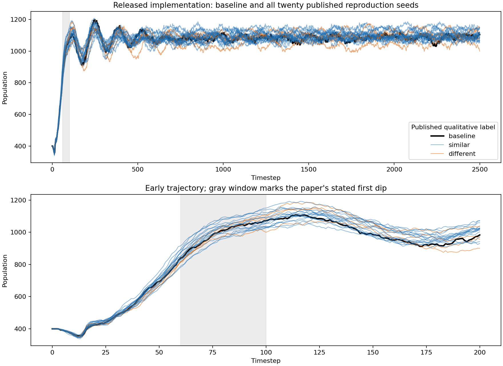

# Replacing Sugarscape (Kremer-Herman and Gupta, SimuTools 2023)

Status: incomplete study. These are operational replays, not validated positive or negative paper replications.

The [author-hosted paper](https://digital-terraria-lab.github.io/assets/papers/kremer-herman:2023:replacing-sugarscape.pdf) describes three baseline experiments, twenty additional seeds, seventeen example configurations, and trade/lending comparisons. `published_targets.json` records the seed-level targets and hashes all seventeen released examples.

## Source provenance

The author's [released implementation](https://github.com/digital-terraria-lab/sugarscape) has earliest stable revision `032abd2d2338aadc5ad0287dae7520539f7af57b` (December 20, 2023). This revision is not verified as the exact paper version. No simulation rules are modified. Results use Python 3.11.14 and `PYTHONHASHSEED=0`.

`run.py` reads the original example configuration, retains its bytes and source hashes in the evidence, and invokes the native command-line application. Overrides are seed, headless mode, logging, debug output, and horizon. Figure 2 requires 2,500 steps for reproduction; the other pilots retain the released 500-step horizons. Figure 1/3 screenshot times remain unknown.

## Completed baseline execution

| Released example | Observations | Minimum population | Maximum population | Final population |
| --- | ---: | ---: | ---: | ---: |
| Seasonal migration | 501 | 230 | 250 | 241 |
| Constrained reproduction | 2,501 | 357 | 1,197 | 1,104 |
| Disease | 501 | 143 | 860 | 822 |

All three complete at their requested horizons. Evidence includes raw trajectories, exact configurations, stdout/stderr, source hashes, and runtime manifests. Population, consecutive timesteps, seed, all scalar metrics, and all array elements are checked.

The paper describes disease survivors falling to roughly 20; this release reaches 143. Its reproduction figure also appears to settle below this run's final population. These are unresolved discrepancies. Historical source/configuration differences, model implementation, and measurement must be investigated before a negative verdict.

## Observation without changing trajectories

`observe.py` imports the pinned model, extracts the native CLI defaults, applies the native configuration functions, seeds the native random generator, and runs the native lifecycle. A subclass records agent IDs, coordinates, age, vision, metabolism, infection counts, season, and hemisphere after initialization and each timestep. It does not draw random numbers or modify agents.

`audit_observation.py` requires byte-identical native trajectories before accepting supplemental observations. Both disease and seasonal runs pass all 501 observations. Disease infections reach zero at timestep 247 and remain absent at termination. This matches the qualitative eradication/recovery sequence, but not the reported survivor minimum.

Seasonal analysis retains both coordinates and the released cell labels. Source inspection finds initial season assignment uses the y coordinate while the hemisphere label uses x. This needs auditing before interpreting north/south occupancy; no coordinate convention has been silently corrected.

## Run

Use Python with Pydantic 2 and an unmodified checkout at the pinned release. Output directories must not exist.

```bash
python replications/replacing_2023/run.py ENGINE disease_basic 12345 OUTPUT
PYTHONHASHSEED=0 PYTHONDONTWRITEBYTECODE=1 python replications/replacing_2023/observe.py ENGINE OUTPUT OBSERVED
python replications/replacing_2023/audit_observation.py OUTPUT OBSERVED
```

## Remaining work

- Establish historical source/configuration equivalence and investigate the disease and reproduction discrepancies.
- Analyze seasonal migration, survival, and hibernation from agent observations; verify spatial/season conventions.
- Run and assess all twenty additional published seeds for all three scenarios.
- Define transparent qualitative assessment criteria before classifying those runs. The authors provide no numerical similarity margin.
- Complete the seventeen example validations and trade/lending carrying-capacity comparisons.
- Integrate validated behavior into the Metta-AI engine; these pinned-source replays establish the reference evidence first.

## Pre-conference source diagnostic

The conference took place December 14–15, 2023. The stable archive was created December 20.
[Source audit](historical-source-audit.json) verifies that every top-level archived Python file matches upstream commit `955860e9b6e4d509f4e8fb19439d588659df919c`.
That revision includes December 20 changes to disease modifiers and universal income, but precedes the separate movement/vision change.
The [retained patch](preconference-to-archive.patch) records model changes from the last pre-conference revision, `d57d39dd034fe5926ad51ed5f3f7b6837a2210ac`.
All three example configurations are byte-identical across these revisions.

The last pre-conference revision was selected by chronology, before observing its results; it is not a verified paper pin.
Its disease baseline completes 500 steps with minimum population 136 and final population 956.
The observation replay is byte-identical across all 501 native records.
This revision still does not reproduce the paper's approximately twenty survivors; chronology alone does not resolve the mismatch.
Both releases and their evidence remain retained. No version is selected merely because it produces a closer result.

`run_published_seeds.py` now executes all twenty Table 3 seeds, in printed order, through the same verified runner.
The archived-release disease batch is running. It records each complete trajectory and does not assign subjective similarity verdicts.
The two explicitly reported extinction seeds, 12881 and 22744, provide concrete outcomes to compare once the batch completes.

The pre-conference constrained-reproduction run also completes all 2,500 steps.
[Full comparison](results/preconference-2026-10-15/reproduction-comparison/comparison.json) finds identical populations at every one of 2,501 observations.
Only `meanHappiness` differs, at 2,500 observations; every other logged field agrees.
Thus these December changes cannot explain the reproduction-population mismatch.
Both runs have population 840 at timestep 60 and 1,071 at timestep 100, rather than the paper's described first major decline in that interval.
Descriptive windows and a [comparison plot](results/preconference-2026-10-15/reproduction-comparison/revision-comparison.png) are retained without treating those windows as statistical equivalence tests.

## Complete twenty-seed disease replay

The [archived-release batch](results/disease-published20-2026-10-15/audit.json) completed all twenty original Table 3 seeds at the released 500-step horizon.
Independent validation checks all 10,020 observations, native source/configuration hashes, original seed ordering, initial populations, finite metrics, and complete trajectories.
No seed becomes extinct. The paper's reported extinction seeds, 12881 and 22744, finish with 801 and 860 agents respectively.
Their minimum populations are 51 and 135.
All raw trajectories, run manifests, logs, and outcomes are retained; no seed is excluded.

The full twenty-seed pre-conference batch and infection-observation replays are complete; results follow below.
The paper's exact assessment times and source revision remain unverified; this result is not yet a validated negative replication.

[Infection observation replays](results/disease-extinction-seed-observations-2026-10-15/eradication-audit.json) for seeds 12881 and 22744 completed successfully.
All 1,002 native trajectory records match their original runs byte for byte.
Infections reach zero at timesteps 30 and 42 respectively and never return through timestep 500.
Both populations recover. Thus these released runs do not contain a continuing epidemic at the stopping horizon.
Exact historical-rule/configuration alignment remains unresolved; this evidence alone does not establish a paper-level negative replication.

## Complete pre-conference seed comparison

The [pre-conference twenty-seed batch](results/preconference-disease-published20-2026-10-15/audit.json) also completed successfully and passes the independent 10,020-observation audit.
[All forty runs](results/preconference-disease-published20-2026-10-15/revision-comparison.json) retain their original seeds, configurations, and complete trajectories.
Neither revision produces an extinction by the released 500-step horizon.
Pre-conference seeds 12881 and 22744 finish at populations 801 and 984, with minima 51 and 110.
The post-conference disease changes therefore do not explain the two reported extinction outcomes by themselves.
Earlier source/configuration provenance and the paper's assessment horizon still require investigation.

## Seasonal identity tracking and remaining seed runs

All twenty published seasonal seeds and their observational replays are complete. The twenty-seed reproduction batch remains in progress.
Each completed batch receives an independent full-trajectory audit.
The seasonal batch then replays every seed with agent observations and requires byte-identical native trajectories before accepting those observations.
The generalized batch auditor has also revalidated the completed disease batch without changing its outcomes.

The [baseline seasonal cohort analysis](results/seasonal-cohort-pilot-2026-10-15/cohorts.json) verifies the actual cell-season convention at all 501 observations.
Actual seasons follow the y-coordinate halves, despite the separate x-based hemisphere label.
The analysis tracks the original agents in the wet half immediately before each seasonal flip, excluding replacement agents from migration counts.
After the first flip, 100 of 199 cohort agents enter the newly wet half during the next 50 steps; 93 of those migrants are absent by the window's end.
An endpoint-only count would miss those migrations, so both events and final survival/location are reported separately.
Nine transition cohorts are retained. Presence in the dry half alone is not classified as hibernation, and no numerical paper-similarity threshold is inferred.

## Complete seasonal ensemble

[Retained evidence](results/seasonal-published20-2026-10-15) covers all twenty Table 3 seeds, with 10,020 native observations and byte-identical observer replays.
`analyze_seasonal_ensemble.py OBSERVED OUTPUT` requires every original seed and analyzes nine complete seasonal windows per seed.
The executable ensemble analysis reproduces the independently assembled summary byte-for-byte.

Across 180 windows, 33,612 wet-half cohort memberships include 14,369 migrations; 11,852 migrant memberships are absent at the window's end.
Memberships can include the same agent in different windows and are not independent samples.
Migrants have higher mean vision than non-migrants in all twenty seeds.
Pooled membership means are 4.015 versus 3.247 vision and 1.428 versus 1.741 sugar metabolism.
Survivors ending in the dry half average 2.930 vision and 1.045 metabolism.
These associations support the paper's directional description of vision and migration under the tested released configuration.

Absence does not establish starvation: the configured maximum lifespans range from 60 to 100 steps.
Dry-half presence does not establish the paper's hibernation behavior.
Historical revision equivalence, cause-specific mortality, and a predeclared quantitative interpretation of the paper's qualitative similarity criterion remain unresolved.
This is additional measured evidence, not a completed paper-level replication.

## Cause-specific seasonal mortality pilot

The observer now copies native death records before the original statistics method clears them, without changing simulation rules or random draws.
`audit_deaths.py BASELINE OBSERVED` first requires native trajectory parity, then reconciles disappearing identities and every native per-step cause count.
`analyze_seasonal_deaths.py OBSERVED OUTPUT` joins those causes to original wet-half cohorts across all nine complete seasonal windows.

[Seed 14133 evidence](results/seasonal-deaths-pilot-2026-10-15) preserves 501 byte-identical native observations and 4,204 individual death records.
The full run contains 2,775 starvation deaths and 1,429 aging deaths, with no combat or disease deaths.
Cohort results separate migration, survival, starvation, and aging without counting replacement agents as survivors.
Native cause labels identify proximate deaths; they do not establish the causal effect of seasons.
The complete twenty-seed cause-specific analysis is now available below.

## Complete seasonal death analysis

[All twenty seeds](results/seasonal-deaths-published20-2026-10-15/summary/summary.json) pass native trajectory parity, identity reconciliation, and per-step death-cause count checks across 10,020 observations.
The observer records the original implementation's cause labels before statistics clears the death registry.
Each seed is analyzed with `audit_deaths.py` and `analyze_seasonal_deaths.py`; `summarize_seasonal_deaths.py OBSERVED COHORTS OUTPUT` verifies all original seeds and evidence hashes.

Across 180 windows, 33,612 original wet-half cohort memberships partition into 21,883 aging deaths, 8,140 starvation deaths, and 3,589 survivors.
No cohort member dies of combat or disease. Aging exceeds starvation in every seed.
These counts explain why disappearance cannot be equated with starvation in this released configuration.
They neither rule out seasonal starvation nor estimate its causal effect.
Memberships may repeat an agent across windows; counts are not independent samples.
The paper's qualitative replication verdict and exact historical configuration remain unresolved.

## Complete example coverage and trade/lending design

`run_examples.py ENGINE NEW_OUTPUT` executes all seventeen Table 4 configurations with their original seeds and released horizons.
Only headless execution, debug output, and log destinations change.
The runner retains each native exit status, complete trajectories, source/configuration hashes, extinction endpoints, and nonfinite scalar measurements.
All seventeen examples exited successfully and passed `audit_examples.py BATCH NEW_OUTPUT` across 6,187 native observations.
[Retained evidence](results/all-examples-2026-10-15) includes byte-preserving compressed configurations, trajectories, logs, manifests, and an independent audit.
Operational completion does not imply agreement with the paper's qualitative targets.

[The paired trade/lending protocol](trade-lending-protocol.json) audits the exact configuration differences before the diagnostic outcomes are inspected.
`trade_basic` differs from `spice_growback` only in trade enablement, excluding descriptive text.
`lending_basic` differs only in lending enablement, interest rate, and loan duration.
The planned twenty-seed comparison uses the released 500-step horizon and a declared final-250-step window, with drift and extinction reported separately.
The seeds are borrowed from Table 3, not claimed to be the original trade/lending seeds.
Historical measurement details remain unresolved; a late-window population mean will not be labeled carrying capacity without further evidence.

`run_trade_lending.py ENGINE NEW_OUTPUT` executes the declared sixty paired runs.
`analyze_trade_lending.py BATCH NEW_OUTPUT` independently checks every configuration and trajectory before computing paired results.
Population alone receives an absorbing-zero extension after extinction because all three released configurations disable replacement.
Native data remains unchanged; extension lengths and undefined relative changes are explicit.
The analysis reports early-to-late drift and does not infer equilibrium or a paper replication verdict.

## Complete reproduction schedule and Figure 2 agreement

[All twenty published seeds](results/reproduction-published20-2026-10-15/audit.json) complete the 2,500-step reproduction experiment and pass 50,020 native-observation checks, with no extinctions.
`analyze_reproduction.py BATCH AUDIT BASELINE NEW_OUTPUT` reports exploratory population descriptors and plots all trajectories against seed 12345.
It uses the paper's 60–100 window and an explicitly analyst-chosen late window; it does not invent a threshold for the qualitative Table 3 labels.
The baseline population rises from 840 to 1,071 during steps 60–100.
All twenty additional seeds also have a window minimum above their pre-step60 peak.

The apparent timing discrepancy is not a failure to reproduce Figure 2.
`audit_figure2.py PDF BASELINE NEW_OUTPUT` renders page9 with `pdftocairo`, extracts its vector curve, and calibrates against the inspected axis labels and rectangle.
[All 2,452 represented vertices](results/figure2-vector-2026-10-15/audit.json) match the baseline's integer populations exactly after coordinate rounding.
Maximum coordinate rounding distances are 0.077 timestep and 0.051 agent; the 49 unrepresented timesteps are explicitly listed, not treated as observed.
Calibration uses the figure axes, not a fit to simulation outcomes.
Thus the released implementation reproduces the plotted curve while the prose's stated first-dip timing disagrees with that curve.
The exact historical revision and Table 3's qualitative classification remain unresolved, so this finding does not complete the paper replication.



## Completed paired trade/lending diagnostic

[All sixty native runs](results/trade-lending-paired20-2026-10-15/analysis.json) pass independent configuration, seed, trajectory, and checksum checks.
Under the declared steps251–500 window, the twenty paired relative increases average 2.421% for trade and 3.359% for lending.
Maximum increases are 6.182% and 7.610%, respectively; each treatment has two negative pairs.
No run becomes extinct and no relative denominator is undefined.
Early-to-late population mean differences span 214.212–273.560 agents across conditions, so the overall run contains a substantial transient.
A final-window mean alone does not establish carrying capacity or equilibrium.

The mean increases are near the paper's descriptive 3%, while the maxima exceed its reported 5%.
The diagnostic reuses Table3 seeds from other scenarios; the original trade/lending seeds, horizon, measurement window, and exact historical controls remain unknown.
Consequently neither agreement nor disagreement constitutes a completed paper replication.
Original configurations, full trajectories, native logs, the predeclared protocol, and paired measurements are retained without dropping unfavorable seeds.

## Earliest 500-step disease release

Configuration history identifies `2d439ff1a8f2fff5e35e168fb610397dc35bfcdb` (May13,2023) as the first released 500-step disease example.
The preceding changes rename four disabled pollution options and extend the original 200-step horizon.
The resulting configuration is identical to the November pre-conference configuration.
This revision was selected by that historical boundary before examining outcomes, not by closeness to the paper.

[Three unchanged-code runs](results/first-disease-release-2026-10-16/audit.json) complete with native exit zero and 1,506 consecutive observations.
Seed12345 reaches a minimum population of41 and ends at687.
The reported extinction seeds12881 and22744 reach minima91 and91, ending at1,372 and909.
Neither becomes extinct. The historical native loop executes through timestep501 for a configured500-step run; all original records remain retained.

These runs use Python3.12 with Tk available; earlier replays used Python3.11.
The historical code imports its GUI even in headless mode. No source changes or import stubs were applied.
The runtime difference prevents attributing every trajectory difference solely to code revision.
This source boundary does not resolve the paper pin, disease discrepancy, or qualitative seed classifications.

## Matched-runtime disease comparison

[Six controlled reruns](results/matched-runtime-2026-10-16/audit.json) run both historical revisions under Python3.12.4 with `PYTHONHASHSEED=0`.
Each uses the original disease example, changing only seed, headless mode, and log destination.
All six native commands exit successfully; their 3,009 records pass consecutive-time and population checks.
All three early-release trajectories repeat exactly. All three archived-release trajectories match every field of the earlier Python3.11 runs.
Thus the observed Python-version change does not explain the disease discrepancies for these seeds and releases.
Neither historical release produces either reported extinction.

Source history records changes to endowment generation, random-stream handling, and disease modifiers between these releases.
The paired runs do not isolate those individual changes or establish the paper's exact revision.
The historical mismatch remains unresolved; this is not a completed negative replication.

## Disease horizon and eradication audit

Sections 5.3–5.4 specify complete population extinction from sickness for seeds 12881 and 22744, but provide no numerical stopping time.
The released 500-step horizon therefore remains an unverified paper setting.

[A source audit](results/disease-eradication-source-2026-10-16/source-audit.json) records all infection-related call sites and hashes every top-level Python source in the archived revision.
Initialization seeds diseases once. Later transmission requires an infected agent; newborns initialize an empty infection list.
Consequently zero infections is absorbing during ordinary headless execution without external intervention.
The existing byte-identical observer replays reach that state at steps 30 and 42 and retain positive populations through step 500.
Extending those runs cannot create another epidemic under these rules.
This does not prove indefinite population survival or exclude lingering modifier effects after infection clears.

The stopping-time ambiguity alone cannot explain renewed transmission in these trajectories.
Historical source and configuration differences remain unresolved, so the study remains incomplete rather than a validated negative replication.

## Figure 3 survivor-panel audit

The [embedded-image audit](results/figure3-panel-2026-10-16/audit.json) reads the lower-left panel of Figure3 directly from PDF page10.
Its 50-by-50 grid contains 18 blue agent cells and no red agent cells.
All nine center-sampling offsets within half a pixel identify the same cells; the extracted image and coordinates are retained.
This agrees with the prose’s roughly20 survivors, independently of the replay outputs.
The paper’s165-agent statement concerns an intermediate population, not initialization or an exact infection count.

Both existing baseline observer summaries were rechecked against raw agent observations and native trajectories across1,002 records.
The archived and pre-conference runs have minimum populations143 and136; neither contains the pictured18-agent state through step500.
Their minimum populations after infection clears are647 and155, respectively.
Unlike Figure2’s timing discrepancy, this mismatch is supported by both the disease image and prose.
The panel has no timestep label, and the historical source/configuration remains unresolved; this does not establish a completed negative replication.

## Real GUI versus headless disease execution

[Three graphical runs](results/gui-parity-2026-10-16/independent-audit.json) use the original Tk interface, Disease coloring menu, and Play button.
The driver subclasses only window setup to schedule those original widget invocations; simulation source files remain unchanged and hash-verified.
Python3.12.4 and bundled Tcl8.6.12 run seeds12345,12881,22744 for the original500 steps.
All1,503 native observations match the previously validated headless trajectories byte for byte.
Only headless mode and log destination differ in the configurations.
The first launch failed before simulation because Tcl scripts were undiscovered; its error is retained, and the successful launch selects the bundled library paths.

The baseline finishes with822 agents; the two reported extinction seeds finish with801 and860.
Their minimum populations remain143,51,135.
A separate check of both saved baseline observers finds no overlapping coordinates across1,002 observations.
Thus ordinary GUI execution and coordinate overlap do not explain the disease-figure discrepancy for these tested runs.
This does not establish equivalence to the paper’s unknown historical revision or exclude other interactive interventions.

## Conference presentation provenance

The [conference-hosted slides](https://simutools.eai-conferences.org/2023/static/uploads/sites/782/2024/01/Replacing-Sugarscape-EAI-SimuTools-2023.pdf) provide another primary source.
The [source audit](results/conference-slides-2026-10-16/audit.json) records the16-page PDF hash, metadata, and inspected claims.
Slide11 repeats the disease image without snapshot times, complete settings, or an immutable source revision.
Slide6’s200-step seed98765 demonstration is separate from the paper’s seed12345 validation experiments; its settings are not substituted into our replays.
Slide3’s500-step introduction demo likewise does not establish the disease experiment’s stopping time.
Slide13 repeats the5percent maximum trade/lending claim without the original measurement protocol.
The presentation therefore corroborates targets but does not resolve historical fidelity.

## Long-horizon trade/lending qualification

[The frozen horizon-extension protocol](results/trade-long-horizon-protocol-2026-10-20) extends the same three conditions to 10,000 steps for seed 14133. It requires exact equality of every original record through step 500, then reports ten fixed 1,000-step windows and paired means over steps 5,001–10,000. The local pilot runs one condition at a time, bounded to 900 seconds each. This is a declared sensitivity to the observed transient, not a recovered paper horizon. Execution and independent audit remain pending.
