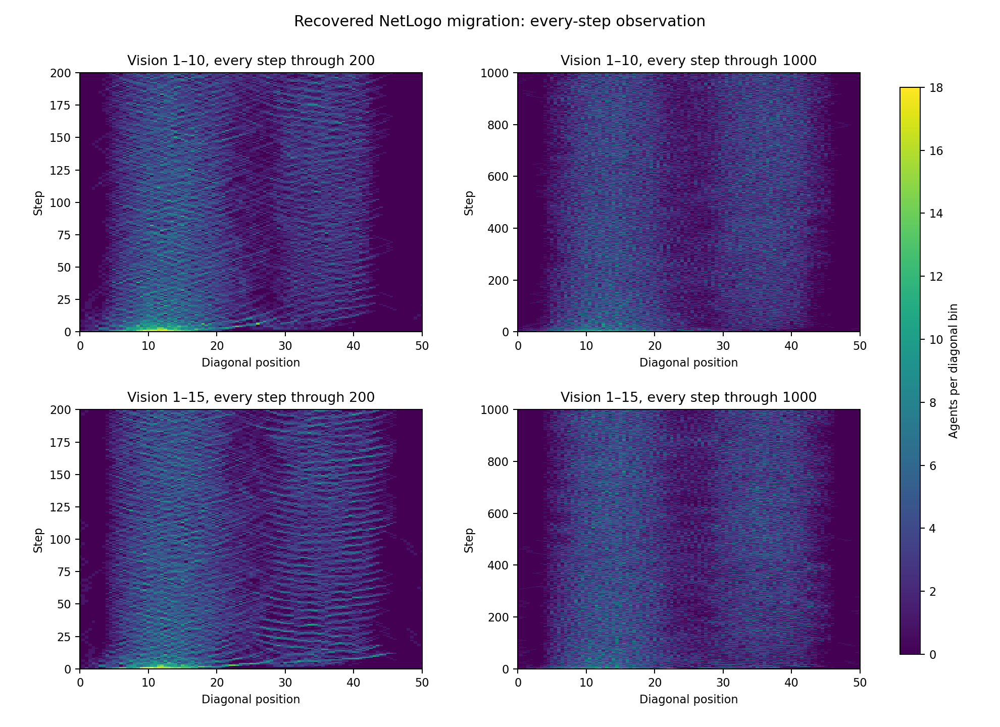
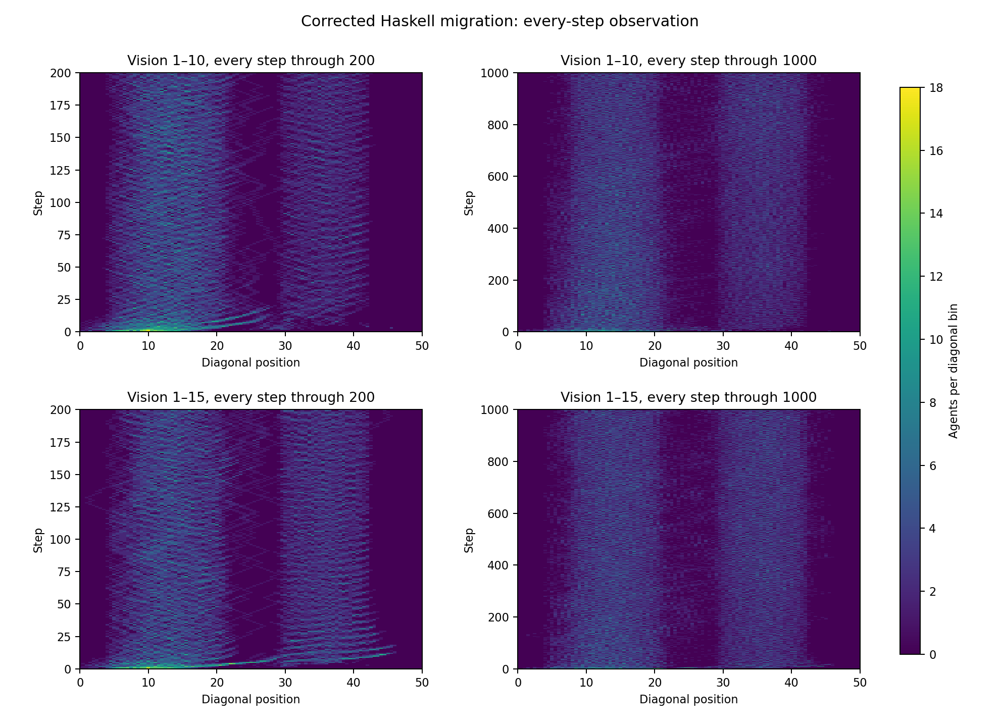

# Migration at full temporal resolution

Appendix A.4 describes waves travelling between the resource peaks and claims
that vision 15 makes them more prominent and persistent. It gives no regression
criterion. Final population alone does not measure that claim.
The previous spatial plots sampled every ten steps, which can obscure fast bands.

The retained NetLogo trajectories already contain every step. Reanalysis recovers
1,001 spatial profiles per case from the same 456,185 agent observations.
Every tenth full-resolution profile equals the previously published profile exactly.
No simulation was rerun or additional independent seed introduced for NetLogo.

The two corrected Haskell cases were rerun with the same compiled binary, seed
602352629, configurations and 1,000-step horizon, changing observation stride from ten to one.
Both native runs exit zero with one CPU and a 3 GiB memory limit.
All 2,002 summary rows match the prior runs byte-for-byte.
All 202 previously sampled agent and cell frames also match exactly.

| Haskell case | Frames | Agent observations | Cell observations |
| --- | ---: | ---: | ---: |
| Vision 1–10 | 1,001 | 144,481 | 2,603,601 |
| Vision 1–15 | 1,001 | 150,311 | 2,603,601 |

The streaming audit verifies every frame's coordinate uniqueness, agent identities,
survivor subsets, exact cell occupancy, finite values, and population/resource accounting.
There are no occupancy disagreements in 5,207,202 cell observations.
Source hashes, binary identity, complete summary parity and sampled-frame parity pass.
The 17,759,656-byte native archive reproduces the audit exactly after extraction.

Both figures use all steps, diagonal bins spaced by half a coordinate unit,
and a common absolute color range of zero to eighteen agents per bin.
Diagonal position is `(x+y)/2` after shifting the coordinate origin to zero.
The left panels show the first 200 steps; the right panels retain all 1,000.
These display windows are not fitted acceptance criteria.





Visual inspection reveals diagonal travelling bands in the recovered NetLogo
captures, particularly with vision 15. The ten-step views obscure this detail.
This is a descriptive observation from the existing diagnostic seed, not a
quantified persistence comparison or an authenticated historical replication.
The Haskell and NetLogo configurations, random streams and population counts differ;
the four previously documented configuration differences remain confounds.
No negative migration verdict follows from the coarser plots.

`haskell/native-evidence.tar.gz` retains complete raw CSVs, protocol, execution
receipts and the streaming auditor. It references the unchanged source and binary
from the preceding corrected-spatial run through recorded hashes.
`netlogo/audit.py` consumes the previously published native-candidate run archive.
Both compressed audit reports retain every spatial profile.
The public plot scripts contain the final label layout; the native archive
also preserves the earlier plot layout from before visual review.

```sh
python haskell/audit.py FULL_HASKELL_RUN PRIOR_CORRECTED_SPATIAL_RUN NEW_HASKELL_AUDIT.json
python netlogo/audit.py PRIOR_NETLOGO_RUN NEW_NETLOGO_AUDIT.json
```

To regenerate plots, decompress each `audit.json.gz` beside its `plot.py`.
The NetLogo plot's exact-subsampling check also requires the prior candidate audit
at the external sibling path recorded in the script. All source trajectories
remain preserved; these repeats add no independent ensemble samples or paper credit.
